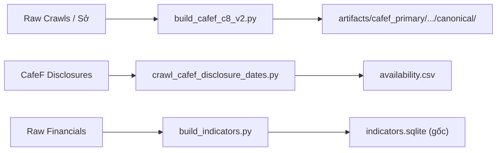
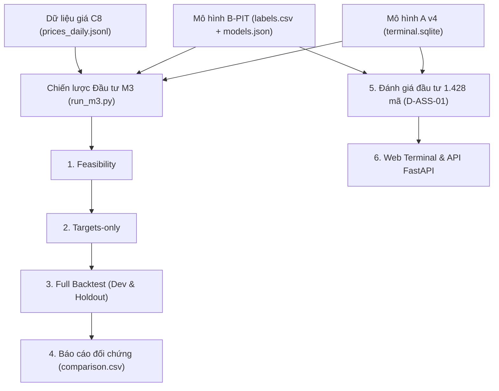

# HƯỚNG DẪN THỰC THI TOÀN BỘ DỰ ÁN DELTA TỪ M1 ĐẾN M3

Tài liệu này hướng dẫn chi tiết quy trình tái lập và thực thi toàn diện dự án **DELTA (Hệ thống phân cụm động lượng & tài chính TTCK Việt Nam)** từ giai đoạn chuẩn bị dữ liệu, phân cụm đến kiểm định chiến lược đầu tư và khởi chạy giao diện Web/API.

Toàn bộ quy trình sử dụng:
* **Hệ thống Thị trường:** Mô hình phân cụm động lượng thị trường **A v4** ($k=3$).
* **Hệ thống Tài chính:** Mô hình phân cụm tài chính **B-PIT Enriched** ($k=3$) trên tập dữ liệu đã làm giàu (loại trừ hoàn toàn rò rỉ thời gian).
* **Nguồn dữ liệu đóng gói chính thức:** Tệp nén tổng hợp **`delta_data_tong_hop.zip`**.

---

## MỤC LỤC

1. [Yêu cầu môi trường và Thiết lập ban đầu](#1-yêu-cầu-môi-trường-và-thiết-lập-ban-đầu)
2. [Bước khởi tạo: Giải nén tệp dữ liệu tổng hợp `delta_data_tong_hop.zip`](#2-bước-khởi-tạo-giải-nén-tệp-dữ-liệu-tổng-hợp-delta_data_tong_hopzip)
3. [Giai đoạn M1: Thu thập và Tiền xử lý dữ liệu (Data Ingestion)](#3-giai-đoạn-m1-thu-thập-và-tiền-xử-lý-dữ-liệu-data-ingestion)
   * [3.1. Nhánh Thị trường: Dữ liệu giao dịch lịch sử C8](#31-nhánh-thị-trường-dữ-liệu-giao-dịch-lịch-sử-c8)
   * [3.2. Nhánh Tài chính: Ngày công bố PIT và Chỉ số tài chính gốc](#32-nhánh-tài-chính-ngày-công-bố-pit-và-chỉ-số-tài-chính-gốc)
4. [Giai đoạn M2: Mô hình hóa và Phân cụm (Clustering & Enrichment)](#4-giai-đoạn-m2-mô-hình-hóa-và-phân-cụm-clustering--enrichment)
   * [4.1. Nhánh Thị trường: Huấn luyện phân cụm Động lượng A v4 (k=3)](#41-nhánh-thị-trường-huấn-luyện-phân-cụm-động-lượng-a-v4-k3)
   * [4.2. Nhánh Tài chính — Bước 1: Làm giàu dữ liệu 9 chỉ số (Stage C)](#42-nhánh-tài-chính--bước-1-làm-giàu-dữ-liệu-9-chỉ-số-stage-c)
   * [4.3. Nhánh Tài chính — Bước 2: Huấn luyện phân cụm B-PIT Enriched (Stage D)](#43-nhánh-tài-chính--bước-2-huấn-luyện-phân-cụm-b-pit-enriched-stage-d)
5. [Giai đoạn M3: Kiểm định chiến lược đầu tư và Vận hành sản phẩm](#5-giai-đoạn-m3-kiểm-định-chiến-lược-đầu-tư-và-vận-hành-sản-phẩm)
   * [5.1. Kiểm tra tính khả thi danh mục (Feasibility Review)](#51-kiểm-tra-tính-khả-thi-danh-mục-feasibility-review)
   * [5.2. Chạy thử nghiệm danh mục mục tiêu (Targets-Only)](#52-chạy-thử-nghiệm-danh-mục-mục-tiêu-targets-only)
   * [5.3. Thực thi Full Backtest tính toán lợi suất danh mục thực tế](#53-thực-thi-full-backtest-tính-toán-lợi-suất-danh-mục-thực-tế)
   * [5.4. So sánh đối chứng hiệu quả chiến lược (Comparison Audit)](#54-so-sánh-đối-chứng-hiệu-quả-chiến-lược-comparison-audit)
   * [5.5. Xây dựng bộ dữ liệu Đánh giá đầu tư D-ASS-01 (Stage S3)](#55-xây-dựng-bộ-dữ-liệu-đánh-giá-đầu-tư-d-ass-01-stage-s3)
   * [5.6. Khởi chạy giao diện Web Terminal và Backend API](#56-khởi-chạy-giao-diện-web-terminal-và-backend-api)

---

## 1. Yêu cầu môi trường và Thiết lập ban đầu

### 1.1. Yêu cầu hệ thống
* **Hệ điều hành:** Windows 10/11, macOS, hoặc Linux.
* **Python:** Phiên bản `>= 3.10` (khuyến nghị **Python 3.12**).
* **Node.js:** Phiên bản `>= 18.x` (để chạy giao diện Web Next.js).
* **RAM:** Tối thiểu 8 GB (khuyến nghị 16 GB để đọc dữ liệu giá C8).

### 1.2. Cấu hình biến môi trường `PYTHONPATH`
Mọi lệnh Python phải nhận diện gói module mã nguồn `src/` của dự án:

* **Trên Windows PowerShell:**
  ```powershell
  $env:PYTHONPATH = "src"
  ```
* **Trên Linux / macOS Terminal (Bash/Zsh):**
  ```bash
  export PYTHONPATH="src"
  ```

---

## 2. Bước khởi tạo: Giải nén tệp dữ liệu tổng hợp `delta_data_tong_hop.zip`

Tệp `delta_data_tong_hop.zip` (148.2 MB) là gói dữ liệu khép kín chứa toàn bộ cơ sở dữ liệu thị trường A v4, dữ liệu tài chính làm giàu, mô hình phân cụm, kết quả backtest và bộ đánh giá đầu tư.

### Lệnh thực thi:
Mở terminal tại thư mục gốc của repository (`Phân cụm động lượng TTCK/`) và chạy:

* **PowerShell:**
  ```powershell
  python -c "import zipfile; print('Đang giải nén dữ liệu...'); zipfile.ZipFile('delta_data_tong_hop.zip', 'r').extractall('.'); print('Giải nén hoàn tất 100%!')"
  ```
* **Linux / macOS:**
  ```bash
  unzip -o delta_data_tong_hop.zip -d .
  ```

### Kết quả đầu ra sau khi giải nén:
Thư mục `data/` trong dự án sẽ được thiết lập đầy đủ cấu trúc:
* `data/web/delta-intelligence-v4/terminal.sqlite` (Mô hình thị trường A v4).
* `data/financial/indicators_enriched_v1/` (CSDL tài chính làm giàu).
* `data/financial/b_pit_enriched_v1/` (Mô hình và nhãn phân cụm tài chính B-PIT Enriched).
* `data/experiments/assessment/assessment_v1_run01/` (5 tệp đánh giá đầu tư D-ASS-01).
* `data/experiments/m3/` (Toàn bộ 211 tệp kết quả backtest Development, Holdout và Comparison).

---

## 3. Giai đoạn M1: Thu thập và Tiền xử lý dữ liệu (Data Ingestion)

Giai đoạn M1 chịu trách nhiệm thu thập dữ liệu thô từ các Sở giao dịch và CafeF, làm sạch và chuẩn hóa thành dữ liệu cấp sơ cấp (Canonical Data).



### 3.1. Nhánh Thị trường: Dữ liệu giao dịch lịch sử C8
Nhiệm vụ thu thập toàn bộ lịch sử khớp lệnh từng ngày của các cổ phiếu trên sàn HOSE, HNX, UPCOM cùng chỉ số VNINDEX và lịch giao dịch (10 năm: 2016–2025).

* **File code thực thi chính thức:** `scripts/build_cafef_c8_v2.py`
  *(Lưu ý về tệp `scripts/run_cafef_c8_complete_only.py`: Đây là script kiểm toán lịch sử của phiên bản C8 V1 cũ chỉ chạy trên 952 mã từ 5 gói zip handoff. Phiên bản chính thức hiện hành của dự án là **V2** mở rộng toàn diện cho **1.522 mã** do tệp `build_cafef_c8_v2.py` đảm nhiệm; bạn chỉ cần chạy tệp V2 này).*
* **Lệnh chạy:**
  ```powershell
  python scripts/build_cafef_c8_v2.py
  ```
* **Đầu vào cụ thể (Inputs):**
  1. Lịch giao dịch các sàn: `data/market_2016_2025/canonical/trading_calendar.jsonl`
  2. Dữ liệu lịch sử chỉ số VNINDEX: `data/custom_crawl/benchmark_daily.jsonl`
  3. Chuỗi giá ngày lịch sử 10 năm: `data/market_2016_2025/canonical/prices_daily.jsonl`
  4. Danh mục 1.522 mã chứng khoán: `artifacts/reports/m1-market-foundation-v2/per_security.csv`
  5. Cấu hình danh mục mở rộng: `configs/data/cafef_expansion_v1/universe.json`
* **Đầu ra (Outputs):** Thư mục `artifacts/cafef_primary/cafef-c8-complete-only-v2/canonical/` gồm:
  1. `prices_daily.jsonl`: Chuỗi giá đóng cửa chưa điều chỉnh, giá điều chỉnh, khối lượng và giá trị giao dịch từng ngày của 1.522 mã cổ phiếu.
  2. `benchmark_daily.jsonl`: Chuỗi điểm số chỉ số tham chiếu VNINDEX từng phiên.
  3. `trading_calendar.jsonl`: Lịch giao dịch đóng/mở cửa các phiên.
  4. `candidate_universe.csv`: Danh sách 1.522 mã chứng khoán chuẩn hóa.
  5. `manifest.json`: Tệp khóa mã băm toàn vẹn C8 V2.
* **Lệnh kiểm tra (Verification):**
  ```powershell
  python scripts/verify_cafef_c8_results.py
  ```

---

### 3.2. Nhánh Tài chính: Ngày công bố PIT và Chỉ số tài chính gốc
Nhiệm vụ xây dựng bảng ngày công bố khả dụng thực tế (Point-in-Time) và tính toán 9 chỉ số tài chính cơ bản chuẩn thị trường (Quy chuẩn D-IND-01).

#### Bước 3.2.1: Xây dựng bảng ngày công bố thông tin (Availability Table)
Áp dụng quy tắc trễ `LAG_RULE` (30/06 năm sau) cho niên độ trước 2022 và `CAFEF_DISCLOSURE` (ngày gửi thực tế) từ niên độ 2022 trở đi.
* **File code thực thi:** `scripts/build_financial_availability.py`
* **Lệnh chạy:**
  ```powershell
  python scripts/build_financial_availability.py
  ```
* **Đầu vào cụ thể (Inputs):**
  1. Danh mục mã cổ phiếu tài chính: `m3/disclosure_dates_v1/b-tickers.txt`
  2. Thư mục nhật ký cào công bố thông tin CafeF: `m3/disclosure_dates_v1/full-20261025/records/` (chứa các tệp CSV ngày gửi của từng mã)
* **Đầu ra (Outputs):**
  * `data/financial/disclosure_dates_v1/availability-4f0f83108e761dae/availability.csv`

#### Bước 3.2.2: Tính toán 9 chỉ số tài chính cơ bản gốc (`indicators_v1`)
Tính toán các chỉ số: `roe`, `roa`, `gross_margin`, `net_margin`, `debt_to_equity`, `current_ratio`, `asset_turnover`, `revenue_growth`, `cfo_to_ni`, cùng điểm Piotroski F-Score và Altman Z-Score theo chuẩn D-IND-01.
* **File code thực thi:** `scripts/build_indicators.py`
* **Lệnh chạy:**
  ```powershell
  python scripts/build_indicators.py
  ```
* **Đầu vào cụ thể (Inputs):**
  1. Cơ sở dữ liệu EPS và kết quả kinh doanh gốc: `data/financial/financial_serving_v1/results/source-period-eps-v3/reported-eps.sqlite`
  2. Bảng ngày công bố Point-in-Time: `data/financial/disclosure_dates_v1/availability-4f0f83108e761dae/availability.csv`
* **Đầu ra (Outputs):**
  * `data/financial/indicators_v1/results/indicators-2c4a24e3830d325f/indicators.sqlite`
  * `data/financial/indicators_v1/results/indicators-2c4a24e3830d325f/manifest.json`
* **Lệnh kiểm tra (Verification):**
  ```powershell
  python scripts/verify_indicators.py
  ```

---

## 4. Giai đoạn M2: Mô hình hóa và Phân cụm (Clustering & Enrichment)

Giai đoạn M2 thực hiện phân cụm độc lập: Nhánh Thị trường huấn luyện mô hình A v4 ($k=3$), và Nhánh Tài chính tiến hành làm giàu dữ liệu (Stage C) rồi huấn luyện mô hình B-PIT Enriched ($k=3$, Stage D).

---

### 4.1. Nhánh Thị trường: Huấn luyện phân cụm Động lượng A v4 (k=3)

Mô hình A v4 áp dụng thuật toán K-Means ($k=3$) trên 9 đặc trưng động lượng giá và biến động thị trường theo chu kỳ hàng tháng (Monthly), huấn luyện trên tập cổ phiếu có thanh khoản (`fitted_on = LIQUID_ONLY`), các mã kém thanh khoản được gán vào tâm cụm gần nhất.

* **Cấu hình mô hình:** `configs/experiments/clustering_rework_v2.json`
* **File code thực thi:** `scripts/run_clustering_rework_v2.py` và `scripts/build_delta_bundle_v4.py`
* **Lệnh chạy:**
  ```powershell
  python scripts/run_clustering_rework_v2.py
  python scripts/build_delta_bundle_v4.py
  ```
* **Đầu vào (Inputs):**
  * `artifacts/cafef_primary/cafef-c8-complete-only-v2/canonical/prices_daily.jsonl`
  * `artifacts/cafef_primary/cafef-c8-complete-only-v2/canonical/benchmark_daily.jsonl`
  * `artifacts/cafef_primary/cafef-c8-complete-only-v2/canonical/trading_calendar.jsonl`
* **Đầu ra (Outputs):**
  * `data/web/delta-intelligence-v4/terminal.sqlite` (502 MB: chứa bảng `observations` gán nhãn thị trường, bảng `profiles` chứa tâm cụm, và bảng `snapshots` lưu chỉ số Silhouette, Davies-Bouldin qua 84 tháng).
  * `data/web/delta-intelligence-v4/manifest.json`

---

### 4.2. Nhánh Tài chính — Bước 1: Làm giàu dữ liệu 9 chỉ số (Stage C)

Khắc phục vấn đề dữ liệu tài chính bị khuyết thiếu bằng cách tính toán giá trị trung vị (`IMPUTED_MEDIAN`) từ tập FIT gốc của từng năm tài chính, điền vào 1.111 ô khuyết thiếu hợp lệ cho 1.045 mã–năm (FY2017–FY2024).

* **File code thực thi:** `scripts/build_enriched_indicators.py`
* **Lệnh chạy:**
  ```powershell
  python scripts/build_enriched_indicators.py `
      --indicators-db data/financial/indicators_v1/results/indicators-2c4a24e3830d325f/indicators.sqlite `
      --availability-csv data/financial/disclosure_dates_v1/availability-4f0f83108e761dae/availability.csv `
      --baseline-bpit-dir data/financial/b_pit_v1/bpit-4a9d2e87f0de84ec `
      --output-dir data/financial/indicators_enriched_v1/indicators_enriched_v1_run01
  ```
* **Đầu vào (Inputs):**
  * CSDL chỉ số gốc: `data/financial/indicators_v1/results/indicators-2c4a24e3830d325f/indicators.sqlite`
  * Bảng ngày công bố: `data/financial/disclosure_dates_v1/availability-4f0f83108e761dae/availability.csv`
  * Baseline B-PIT: `data/financial/b_pit_v1/bpit-4a9d2e87f0de84ec`
* **Đầu ra (Outputs):** Thư mục `data/financial/indicators_enriched_v1/indicators_enriched_v1_run01/` gồm:
  1. `indicators.sqlite`: CSDL 9 chỉ số đã điền trung vị ngành.
  2. `imputed_cells.csv`: Chi tiết 1.111 ô được điền giá trị.
  3. `medians_by_year_metric.csv`: Bảng giá trị trung vị theo năm tài chính.
  4. `imputation_summary.json`: Báo cáo tỷ lệ hoàn tất 9/9 chỉ số.
  5. `manifest.json`: Mã băm kiểm toán đầu ra.
* **Tiêu chuẩn nghiệm thu:** 0 lỗi sai lệch dữ liệu quan sát gốc, bảo toàn 100% các ô đã có số liệu.

---

### 4.3. Nhánh Tài chính — Bước 2: Huấn luyện phân cụm B-PIT Enriched (Stage D)

Huấn luyện mô hình K-Means ($k=3$) trên dữ liệu tài chính đã làm giàu, áp dụng ngày chốt sổ định kỳ Cutoff (30/04 hàng năm) để chống rò rỉ dữ liệu tương lai. Đóng băng tọa độ tâm cụm, phân loại thứ tự chất lượng cụm (Cụm dẫn đầu $\rightarrow$ Cụm trung bình $\rightarrow$ Cụm yếu nhất).

* **Cấu hình mô hình:** `configs/experiments/bpit_enriched_v1.json`
* **File code thực thi:** `scripts/build_financial_pit_clusters_enriched.py`
* **Lệnh chạy:**
  ```powershell
  python scripts/build_financial_pit_clusters_enriched.py `
      --config configs/experiments/bpit_enriched_v1.json `
      --output-dir data/financial/b_pit_enriched_v1/bpit_enriched_v1_run01
  ```
* **Đầu vào (Inputs):**
  * File cấu hình: `configs/experiments/bpit_enriched_v1.json`
  * CSDL làm giàu: `data/financial/indicators_enriched_v1/indicators_enriched_v1_run01/indicators.sqlite`
  * Bảng ngày công bố: `data/financial/disclosure_dates_v1/availability-4f0f83108e761dae/availability.csv`
* **Đầu ra (Outputs):** Thư mục `data/financial/b_pit_enriched_v1/bpit_enriched_v1_run01/` gồm:
  1. `models.json`: Tọa độ tâm cụm K-Means $k=3$ qua các niên độ FY2017–FY2024.
  2. `labels.csv`: Bảng nhãn cụm tài chính gán cho từng mã cổ phiếu.
  3. `audit.json`: Kết quả kiểm toán chống rò rỉ thời gian (`fit_leaks = 0`, độ ổn định ARI đạt $0.922$).
  4. `manifest.json`: Tệp khóa phiên bản mô hình phân cụm.
* **Tiêu chuẩn nghiệm thu:** Trường `fit_leaks` trong `audit.json` phải rỗng tuyệt đối.

---

## 5. Giai đoạn M3: Kiểm định chiến lược đầu tư và Vận hành sản phẩm

Giai đoạn M3 kết hợp nhãn Cụm dẫn dắt thị trường (Hệ A v4) và Cụm tài chính khỏe mạnh (Hệ B-PIT Enriched, loại bỏ cụm yếu nhất theo quy tắc `not_weakest`), tiến hành backtest danh mục và phát hành sản phẩm Web.



---

### 5.1. Kiểm tra tính khả thi danh mục (Feasibility Review)
Kiểm tra số lượng cổ phiếu hợp lệ tại mỗi tháng quyết định trên cả 2 giai đoạn (Development và Holdout), bảo đảm danh mục luôn đáp ứng ngưỡng tối thiểu $N_{min} \ge 10$ mã.

* **File code thực thi:** `scripts/m3_feasibility_variants.py`
* **Cấu hình sử dụng:** `configs/experiments/m3_strategy_enriched_v1.json`
* **Lệnh chạy:**
  ```powershell
  python scripts/m3_feasibility_variants.py --config configs/experiments/m3_strategy_enriched_v1.json
  ```
* **Đầu vào (Inputs):** `terminal.sqlite`, `indicators.sqlite` (enriched), `labels.csv` (bpit enriched).
* **Tiêu chuẩn nghiệm thu:** Trạng thái đánh giá trả về `PASS`.

---

### 5.2. Chạy thử nghiệm danh mục mục tiêu (Targets-Only)
Sinh danh sách mã mục tiêu và tỷ trọng phân bổ từng tháng mà không tính toán giá trị tài sản ròng hay lợi suất (kiểm tra logic lựa chọn danh mục).

* **File code thực thi:** `scripts/run_m3.py`
* **Lệnh chạy cho giai đoạn Development (2019 – 2023):**
  ```powershell
  python scripts/run_m3.py --config configs/experiments/m3_strategy_enriched_v1.json --segment development --targets-only
  ```
* **Lệnh chạy cho giai đoạn Holdout (2024 – 2025):**
  ```powershell
  python scripts/run_m3.py --config configs/experiments/m3_strategy_enriched_v1.json --segment holdout --targets-only
  ```
* **Tiêu chuẩn nghiệm thu:** 
  * Development: Đủ đúng **60 quyết định / 59 kỳ thực thi / 1 kỳ cuối kết thúc đoạn**.
  * Holdout: Đủ đúng **24 quyết định / 23 kỳ thực thi / 1 kỳ cuối kết thúc đoạn**.

---

### 5.3. Thực thi Full Backtest tính toán lợi suất danh mục thực tế
Chạy toàn diện mô phỏng giao dịch hàng tháng, tính toán giá trị NAV, chi phí giao dịch, cổ tức tiền mặt, đo lường tỷ suất sinh lời và chỉ số Sharpe cho cả 5 chiến lược (Combined, Market-only, Financial-only, Equal-weight, Momentum-only).

* **File code thực thi:** `scripts/run_m3.py`
* **Đầu vào bắt buộc (Inputs):**
  * Cấu hình: `configs/experiments/m3_strategy_enriched_v1.json`
  * Dữ liệu giá C8: `artifacts/cafef_primary/cafef-c8-complete-only-v2/canonical/prices_daily.jsonl`
  * Dữ liệu chỉ số VNINDEX: `benchmark_daily.jsonl`
  * Lịch giao dịch HOSE: `trading_calendar.jsonl`
* **Lệnh chạy giai đoạn Development (31/01/2019 – 29/12/2023):**
  ```powershell
  python scripts/run_m3.py --config configs/experiments/m3_strategy_enriched_v1.json --segment development
  ```
* **Lệnh chạy giai đoạn Holdout (31/01/2024 – 31/12/2025):**
  ```powershell
  python scripts/run_m3.py --config configs/experiments/m3_strategy_enriched_v1.json --segment holdout
  ```
* **Đầu ra (Outputs):**
  * Thư mục `data/experiments/m3/development/<run_id>/`
  * Thư mục `data/experiments/m3/holdout/<run_id>/`
  * Gồm: `nav_combined.csv`, `holdings_combined.csv`, `targets_combined.csv`, `metrics.json`, `benchmark_vnindex.csv`.

---

### 5.4. So sánh đối chứng hiệu quả chiến lược (Comparison Audit)
Xác thực mức cải thiện hiệu năng đầu tư của dữ liệu tài chính làm giàu so với bản cơ sở.

* **File code thực thi:** `scripts/verify_m3_enriched_run.py`
* **Lệnh chạy:**
  ```powershell
  python scripts/verify_m3_enriched_run.py
  ```
* **Đầu ra (Outputs):**
  * Bảng so sánh tại: `data/experiments/m3/comparison/20261118T173627755165Z/comparison.csv`
* **Kết quả nghiệm thu:** Chiến lược Combined với B-PIT Enriched mang lại mức vượt trội lợi suất thêm **+35.51%** ở giai đoạn Development và **+14.12%** ở giai đoạn Holdout so với mô hình cơ sở.

---

### 5.5. Xây dựng bộ dữ liệu Đánh giá đầu tư D-ASS-01 (Stage S3)
Chấm điểm toàn diện và phân loại đầu tư độc lập cho 1.428 mã cổ phiếu theo quy tắc D-ASS-01 (tích hợp cụm A, cụm B, điểm F-score $\ge 7$, Z-score $\ge 1.81$).

* **File code thực thi:** `scripts/build_investment_assessment_v1.py`
* **Lệnh chạy:**
  ```powershell
  python scripts/build_investment_assessment_v1.py `
      --indicators-db data/financial/indicators_enriched_v1/indicators_enriched_v1_run01/indicators.sqlite `
      --availability-csv data/financial/disclosure_dates_v1/availability-4f0f83108e761dae/availability.csv `
      --bpit-labels data/financial/b_pit_enriched_v1/bpit_enriched_v1_run01/labels.csv `
      --terminal-sqlite data/web/delta-intelligence-v4/terminal.sqlite `
      --output-dir data/experiments/assessment/assessment_v1_run01
  ```
* **Đầu ra (Outputs):** Thư mục `data/experiments/assessment/assessment_v1_run01/` gồm 5 tệp:
  1. `assessments.jsonl`: Kết quả phân loại 4 nhóm khuyến nghị cho 1.428 mã (67 Đáng cân nhắc, 448 Cần theo dõi, 587 Chưa ưu tiên, 326 Không đủ cơ sở).
  2. `peer_benchmarks.csv`: Bảng so sánh định lượng từng mã với nhóm đối thủ cùng ngành/cùng cụm.
  3. `feature_history.jsonl`: Chuỗi lịch sử các chỉ số phục vụ vẽ đồ thị.
  4. `coverage.csv`: Thống kê độ bao phủ dữ liệu.
  5. `manifest.json`: Mã băm SHA-256 xác thực đầu ra (`deterministic_content_sha256 = 16b259111f...`).
* **Lệnh xác thực kiểm toán (Verification bắt buộc):**
  ```powershell
  python scripts/verify_investment_assessment_v1.py --dir data/experiments/assessment/assessment_v1_run01
  ```
  *(Đầu ra yêu cầu báo `verification_status: PASS`, đủ đúng 1.428 mã cổ phiếu).*

---

### 5.6. Khởi chạy toàn bộ hệ thống Web Terminal và Backend API

Phần này khởi chạy **TOÀN BỘ WEBSITE** của hệ thống DELTA Intelligence (không chỉ riêng tab Đánh giá đầu tư), bao gồm cả máy chủ dịch vụ dữ liệu Backend (FastAPI) và giao diện người dùng tương tác Frontend (Next.js).

Website tổng thể cung cấp đầy đủ các phân hệ chức năng:
* **Trang chủ / Tổng quan (`/`):** Toàn cảnh phân bố 3 cụm thị trường A v4, thống kê quy mô và diễn biến dòng tiền.
* **Bản đồ không gian cụm Atlas (`/atlas`):** Biểu đồ tán xạ 2D PCA thể hiện vị trí tương quan giữa các nhóm cổ phiếu theo động lượng và thanh khoản.
* **Hồ sơ chi tiết cổ phiếu (`/stocks`):** Xem biểu đồ nến kỹ thuật, chuỗi chỉ số động lượng, biến động và **Tab Đánh giá đầu tư D-ASS-01** (phân loại 4 nhóm khuyến nghị, bảng đối sánh ngành Peers và lịch sử chỉ số).
* **Phân tích cơ bản tài chính (`/financial`):** Tra cứu 9 chỉ số tài chính cơ bản, xếp hạng Piotroski F-score và Altman Z-score.
* **Kiểm định chiến lược (`/backtest`):** Hiển thị đồ thị tăng trưởng NAV, so sánh hiệu quả giữa chiến lược Combined và các chiến lược đơn lẻ với chỉ số VNINDEX.
* **Phòng thí nghiệm (`/lab`):** Thử nghiệm lọc và quét cổ phiếu đa tiêu chí.

---

#### 5.6.1. Danh sách ĐẦU VÀO CỤ THỂ (Inputs) của toàn bộ Website
Để toàn bộ các trang và tính năng trên Web hoạt động trơn tru 100%, Backend API cần nạp các tệp đầu vào sau:

1. **Cơ sở dữ liệu thị trường và mô hình A v4 (Bắt buộc cho Trang chủ, Atlas, Biểu đồ nến):**
   * Tệp CSDL trung tâm: `data/web/delta-intelligence-v4/terminal.sqlite` (502 MB)
   * Tệp khóa mã băm: `data/web/delta-intelligence-v4/manifest.json`
2. **Bộ dữ liệu phục vụ Tab Đánh giá đầu tư D-ASS-01 (Bắt buộc cho phân hệ Đánh giá):**
   * Tệp cấu hình định tuyến phát hành: `configs/product/assessment_release_v1.json`
   * Thư mục 5 tệp dữ liệu tại `data/experiments/assessment/assessment_v1_run01/`:
     * `assessments.jsonl` (bảng chấm điểm 1.428 mã)
     * `peer_benchmarks.csv` (bảng đối sánh đối thủ cùng ngành)
     * `feature_history.jsonl` (lịch sử đặc trưng vẽ đồ thị)
     * `coverage.csv` (thống kê độ bao phủ)
     * `manifest.json` (mã băm xác thực)
3. **Cơ sở dữ liệu tài chính (Bắt buộc cho phân hệ Phân tích tài chính):**
   * `data/financial/indicators_enriched_v1/indicators_enriched_v1_run01/indicators.sqlite`
   * `data/financial/financial_serving_v1/results/source-period-eps-v3/reported-eps.sqlite`
4. **Kết quả kiểm định chiến lược (Bắt buộc cho phân hệ Backtest):**
   * Thư mục kết quả Development: `data/experiments/m3/development/20261118T165114Z-46fc18c0/`
   * Thư mục kết quả Holdout: `data/experiments/m3/holdout/20261118T170517Z-46fc18c0/`
   * Báo cáo so sánh đối chứng: `data/experiments/m3/comparison/20261118T173627755165Z/comparison.csv`

---

#### 5.6.2. Các bước cài đặt và Khởi chạy

##### Bước 1: Cài đặt các gói phụ thuộc Frontend (chỉ cần chạy một lần duy nhất)
Mở terminal và di chuyển vào thư mục frontend để cài đặt các thư viện Node.js:
```powershell
cd web/frontend
npm ci
cd ../..
```

##### Bước 2: Chạy lệnh khởi động đồng thời cả Backend và Frontend
Dự án đã trang bị sẵn script điều phối tự động `scripts/start_delta_terminal.py` giúp khởi chạy song song Backend FastAPI trên cổng 8010 và Frontend Next.js trên cổng 3000:

```powershell
python scripts/start_delta_terminal.py
```

*(Nếu muốn chạy ở chế độ bản dựng tối ưu hóa Production: chạy `npm run build` trong `web/frontend` trước, sau đó chạy `python scripts/start_delta_terminal.py --production`).*

---

#### 5.6.3. Danh mục các địa chỉ truy cập (URLs)

* **Giao diện người dùng Web (Frontend Next.js):**
  * Trang chủ / Tổng quan: `http://localhost:3000`
  * Bản đồ cụm Atlas: `http://localhost:3000/atlas`
  * Tra cứu Cổ phiếu & Tab Đánh giá đầu tư: `http://localhost:3000/stocks` *(ví dụ: `http://localhost:3000/stocks?ticker=FPT`)*
  * Phân tích Tài chính: `http://localhost:3000/financial`
  * Kết quả Backtest: `http://localhost:3000/backtest`
* **Tài liệu API Backend Swagger (FastAPI):**
  * `http://localhost:8010/docs` (cho phép kiểm tra thử trực tiếp toàn bộ các API endpoint `/api/v2/...`).

---

## 6. Bảng tổng hợp nhanh các lệnh thực thi (Cheat Sheet)

| Giai đoạn | Thao tác | Câu lệnh thực thi chính |
| :--- | :--- | :--- |
| **Khởi tạo** | Giải nén gói dữ liệu | `python -c "import zipfile; zipfile.ZipFile('delta_data_tong_hop.zip').extractall('.')"` |
| **M1 Thị trường** | Chuẩn hóa giá C8 | `python scripts/build_cafef_c8_v2.py` |
| **M1 Tài chính** | Tính chỉ số tài chính gốc | `python scripts/build_indicators.py` |
| **M2 Thị trường** | Phân cụm Động lượng A v4 | `python scripts/run_clustering_rework_v2.py && python scripts/build_delta_bundle_v4.py` |
| **M2 Tài chính** | Làm giàu 9 chỉ số (Stage C) | `python scripts/build_enriched_indicators.py` |
| **M2 Tài chính** | Phân cụm B-PIT Enriched (Stage D)| `python scripts/build_financial_pit_clusters_enriched.py` |
| **M3 Kiểm tra** | Feasibility Review | `python scripts/m3_feasibility_variants.py --config configs/experiments/m3_strategy_enriched_v1.json` |
| **M3 Danh mục** | Chạy Targets-only | `python scripts/run_m3.py --config configs/experiments/m3_strategy_enriched_v1.json --segment development --targets-only` |
| **M3 Backtest** | Full Backtest Dev | `python scripts/run_m3.py --config configs/experiments/m3_strategy_enriched_v1.json --segment development` |
| **M3 Backtest** | Full Backtest Holdout | `python scripts/run_m3.py --config configs/experiments/m3_strategy_enriched_v1.json --segment holdout` |
| **M3 Đánh giá** | Tạo bộ D-ASS-01 (1.428 mã) | `python scripts/build_investment_assessment_v1.py` |
| **M3 Xác thực** | Verify Assessment | `python scripts/verify_investment_assessment_v1.py --dir data/experiments/assessment/assessment_v1_run01` |
| **Sản phẩm Web**| Chạy Web & API | `python scripts/start_delta_terminal.py` |
