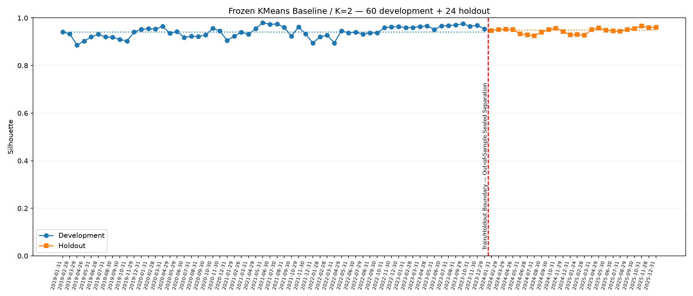

# Báo cáo Nhiệm vụ 11 — Final Holdout

<!-- M2_FINAL_HOLDOUT_FULL_REPORT -->

**Ngày biên soạn:** 22/10/2026. **Phạm vi:** kiểm định ngoài mẫu cho duy nhất
KMeans Baseline/K=2 đã được chọn ở Nhiệm vụ 10. Báo cáo giữ bố cục A/B/C của
mẫu Nhiệm vụ 11 cũ; toàn bộ số liệu dưới đây lấy từ bộ kết quả mới hoàn tất
lúc **15:50:31 ngày 22/10/2026 (UTC+7)** trên nguồn C8 hiện hành.

## A — Gate và thực thi một chiều

### 1. Mục tiêu và phương pháp đã đóng băng

Nhiệm vụ 11 kiểm tra sự duy trì cấu trúc phân cụm trên 24 snapshot ngoài mẫu
2024–2025 sau giai đoạn development 60 tháng 2019–2023. Phương án duy nhất là
**KMeans_Baseline, scikit-learn, Global K=2**, theo
[quyết định Nhiệm vụ 10](../artifacts/m2-evaluation-v2/final_method_decision.json)
trạng thái `FROZEN_FOR_HOLDOUT`. Ward và PCA + K-Means giữ vai trò đối chứng
trong development; không được thực thi trên holdout.

Đóng băng ở đây là giữ thuật toán, tập feature, preprocessing và siêu tham số.
Theo protocol phân cụm độc lập từng tháng, mỗi snapshot holdout được fit Robust
Scaler và K-Means riêng trên cross-section của chính tháng đó; scaler hoặc
centroids development không được dùng để áp chung cho toàn bộ holdout.
Giữ seed=42, n_init=10, max_iter=300, không quét K, không impute/clipping,
không thay feature hoặc chọn lại phương án sau khi xem kết quả.

Tám feature gốc: `mom_21`, `mom_63`, `mom_126`, `mom_252`, `vol_63`, `mdd_126`,
`beta_126`, `liquidity_21`. Universe được lọc theo
`market_experiment_eligible(t) = market_feature_ready_v2(t)` của từng snapshot;
không áp danh sách tháng cuối ngược lại các tháng trước.

### 2. Bằng chứng thực thi

| Hạng mục | Kết quả thực tế |
| --- | --- |
| Phương án duy nhất | KMeans_Baseline / scikit-learn |
| Global K / seed / n_init / max_iter | 2 / 42 / 10 / 300 |
| Development | 60 tháng: 2019-01-31 → 2023-12-29 |
| Holdout | 24 tháng: 2024-01-31 → 2025-12-31 |
| Quyết định đóng băng (UTC+7) | 22/10/2026 12:57:06 |
| Mở holdout (UTC+7) | 22/10/2026 15:49:06 |
| Hoàn tất (UTC+7) | 22/10/2026 15:50:31 |
| Snapshot hợp lệ / bỏ qua | 24 / 0 |
| Universe thực tế | 1141–1410 mã/tháng; trung bình 1256.458333 |
| Ngưỡng universe theo kế hoạch | Ít nhất 100 mã; eligibility riêng từng snapshot |
| Assignments / Profiles / Models | 30155 / 48 / 24 |
| Cặp thời gian / Transition rows / Drift rows | 23 / 92 / 368 |
| Scaler parameters | 192 dòng: 24 tháng × 8 feature |
| Feature version / Data version | 1.6.0 / CAFEF_C8_COMPLETE_ONLY_V2 |
| Packages | numpy 2.3.4; scikit-learn 1.9.1; matplotlib 3.11.2 |
| Manifest | complete; synthetic=false; portfolio_evaluation_enabled=false |

Thời điểm quyết định đóng băng đứng trước thời điểm mở holdout trong lần thực
thi hiện tại. Gate đối chiếu chín development inputs đã pin, 60 selected models
và cấu hình holdout: tổng cộng 70 input references; manifest còn lưu 12 mã băm
source code. Sau thực thi, manifest ghi `methods_executed=['kmeans']` và
`k_values_executed=[2]`. Cả 24 snapshot đều hội tụ và đạt ngưỡng universe.
Tổng **30.155 assignments** là số lượt cổ phiếu–snapshot, không phải số cổ phiếu
riêng biệt. Việc xác minh này không thay thế kiểm toán đầy đủ của Nhiệm vụ 12.

Nguồn là C8 Feature Store 1.6.0 tại `cafef-c8-complete-only-v2`. Mã băm SHA-256:

- Feature snapshots: `ab1a34a83857e78e304dbeea85f05fd3e1fd1f7d93ed89bbcee4731646da740e`.
- Source manifest: `c5bcd72dfc454671d56f7d3b72e4537a67cb11b0da1a5e2fe61d72ac158b8abd`.

Các mã băm này thuộc bộ dữ liệu mới và khớp lineage của phương án được đóng
băng ở Nhiệm vụ 10. Không sửa dữ liệu nguồn, feature store hoặc numerical
artifacts khi biên soạn báo cáo.

### 3. Ranh giới Development/Holdout

Development kết thúc 2023-12-29, holdout bắt đầu 2024-01-31. Dù lịch liên tục,
chuỗi nhãn holdout được bắt đầu mới: **không có transition từ 2023-12-29 sang
2024-01-31**. Chỉ tính 23 cặp nội bộ holdout, từ 2024-01-31 → 2024-02-29
đến 2025-11-28 → 2025-12-31. Quy tắc reset qua tháng thiếu/skip vẫn được giữ;
trong lần chạy này không có gap nội bộ hoặc skip.

## B — Development so với Holdout

### 1. Khoảng cách tổng quát hóa thực tế

| Metric | Số quan sát Dev | Số quan sát Holdout | Median Dev | Median Holdout | Holdout − Dev |
| --- | --- | --- | --- | --- | --- |
| silhouette | 60 | 24 | 0.940837 | 0.949324 | +0.008487 |
| davies_bouldin | 60 | 24 | 0.403127 | 0.398445 | -0.004682 |
| calinski_harabasz | 60 | 24 | 1586.371240 | 3476.393786 | +1890.022546 |
| inertia | 60 | 24 | 376102.139178 | 1340403.029034 | +964300.889855 |
| cluster_balance | 60 | 24 | 0.020996 | 0.022626 | +0.001630 |
| ari | 59 | 23 | 0.757047 | 0.843260 | +0.086213 |
| nmi | 59 | 23 | 0.602909 | 0.721949 | +0.119040 |
| Persistence (%) | 59 | 23 | 99.007092 | 99.370574 | +0.363482 |
| Migration (%) | 59 | 23 | 0.992908 | 0.629426 | -0.363482 |

Hai hàng Persistence/Migration dùng đơn vị %, nên cột chênh lệch tương ứng là
**điểm phần trăm**; các hàng khác giữ đơn vị gốc. Chất lượng dùng 60/24 snapshot,
temporal dùng 59/23 cặp nội bộ, không trộn số quan sát giữa hai lớp metric.
Chênh lệch được tính từ giá trị đầy đủ trước khi làm tròn từng ô.

`Delta_Silhouette = 0.949323876 − 0.940837186 = +0.008486690`.

Median Silhouette tăng **0.008487**, thuộc trường hợp Delta ≥ −0.05 của rubric
kế hoạch. Kết quả mô tả độ phân tách hình học trong mẫu holdout này không suy
giảm theo chỉ số đó. Nó không tự chứng minh không overfit, khả năng dự báo,
sự bền vững ở mọi giai đoạn tương lai hoặc hiệu quả đầu tư.

DB giảm từ **0.403127 xuống 0.398445**, thuận lợi theo hướng đọc DB thấp hơn.
ARI và NMI median cũng tăng. Tuy nhiên, Balance chỉ tăng nhẹ và vẫn thấp.
CH tăng đáng kể, nhưng CH và Inertia còn chịu ảnh hưởng quy mô mẫu/độ phân tán.
Universe holdout **1141–1410 mã** lớn hơn development **503–1134 mã**;
không dùng chênh lệch Inertia tuyệt đối để kết luận holdout kém hơn hoặc quy
toàn bộ thay đổi CH cho chất lượng mô hình.

### 2. Thống kê chất lượng holdout

| metric | n_total | n_available | mean | median | minimum | maximum |
| --- | --- | --- | --- | --- | --- | --- |
| silhouette | 24 | 24 | 0.945891 | 0.949324 | 0.925305 | 0.965754 |
| davies_bouldin | 24 | 24 | 0.397527 | 0.398445 | 0.321662 | 0.466080 |
| calinski_harabasz | 24 | 24 | 3419.291579 | 3476.393786 | 2297.953994 | 4884.204850 |
| inertia | 24 | 24 | 1627102.634924 | 1340403.029034 | 519490.314206 | 4652227.946642 |
| cluster_balance | 24 | 24 | 0.023179 | 0.022626 | 0.016504 | 0.035073 |

Silhouette nằm trong khoảng **0.925305–0.965754**: thấp nhất tại 2024-07-31,
cao nhất tại 2025-10-31. Cả 24 tháng đều vượt 0.70 theo rubric mô tả.
Tuy nhiên **24/24 tháng Balance <0.05**; median Balance chỉ **0.022626**.
Cụm nhỏ có **22–41 mã**, median **28 mã**; cụm lớn có **1111–1384 mã**.
Không có singleton, nhưng cấu trúc vẫn rất bất đối xứng.
Balance là `min_size / max_size`, khác tỷ trọng cụm nhỏ trên tổng số mã.

### 3. Chi tiết 24 snapshot

| Snapshot | Số mã | Cụm nhỏ (mã) | Silhouette | DB | Balance |
| --- | --- | --- | --- | --- | --- |
| 2024-01-31 | 1141 | 30 | 0.947315 | 0.415035 | 0.027003 |
| 2024-02-29 | 1142 | 30 | 0.951056 | 0.340631 | 0.026978 |
| 2024-03-29 | 1143 | 24 | 0.951930 | 0.347068 | 0.021448 |
| 2024-04-26 | 1162 | 26 | 0.950584 | 0.370394 | 0.022887 |
| 2024-05-31 | 1176 | 31 | 0.933255 | 0.388182 | 0.027074 |
| 2024-06-28 | 1197 | 29 | 0.929275 | 0.457003 | 0.024829 |
| 2024-07-31 | 1210 | 41 | 0.925305 | 0.403365 | 0.035073 |
| 2024-08-30 | 1224 | 34 | 0.939507 | 0.440933 | 0.028571 |
| 2024-09-30 | 1352 | 28 | 0.951533 | 0.347406 | 0.021148 |
| 2024-10-31 | 1355 | 22 | 0.956719 | 0.404385 | 0.016504 |
| 2024-11-29 | 1249 | 25 | 0.943247 | 0.465561 | 0.020425 |
| 2024-12-31 | 1258 | 29 | 0.928290 | 0.466080 | 0.023596 |
| 2025-01-24 | 1265 | 33 | 0.929776 | 0.450199 | 0.026786 |
| 2025-02-28 | 1270 | 32 | 0.927461 | 0.419988 | 0.025848 |
| 2025-03-31 | 1272 | 22 | 0.950482 | 0.335645 | 0.017600 |
| 2025-04-29 | 1274 | 22 | 0.957658 | 0.381185 | 0.017572 |
| 2025-05-30 | 1280 | 28 | 0.948166 | 0.412506 | 0.022364 |
| 2025-06-30 | 1287 | 25 | 0.945049 | 0.321662 | 0.019810 |
| 2025-07-31 | 1292 | 35 | 0.943432 | 0.393525 | 0.027844 |
| 2025-08-29 | 1295 | 32 | 0.950974 | 0.441641 | 0.025337 |
| 2025-09-30 | 1299 | 26 | 0.955474 | 0.461795 | 0.020424 |
| 2025-10-31 | 1301 | 23 | 0.965754 | 0.346961 | 0.017997 |
| 2025-11-28 | 1301 | 26 | 0.958927 | 0.377532 | 0.020392 |
| 2025-12-31 | 1410 | 26 | 0.960220 | 0.351963 | 0.018786 |

Median Balance nhích lên so với development (+0.001630), song chưa đủ để gọi
hai nhóm cân bằng. Silhouette cao cần được đọc cùng kích thước cụm và đặc
trưng phân tách; không bỏ cảnh báo chỉ vì cụm nhỏ không phải singleton.

### 4. Quỹ đạo Development/Holdout trên 84 mốc

Hai chuỗi được vẽ riêng, có hai median và đường đỏ đứt tại ranh giới ngoài mẫu.
Không nối đường development với holdout. Biểu đồ trình bày quỹ đạo chất lượng
quan sát được; không phải đồ thị lợi nhuận hoặc kiểm định nhân quả thị trường.

### 5. Temporal stability trong holdout

| Metric | Pairs | Mean | Median | Minimum | Maximum |
| --- | --- | --- | --- | --- | --- |
| ARI | 23 | 0.841247 | 0.843260 | 0.726248 | 0.928083 |
| NMI | 23 | 0.717311 | 0.721949 | 0.549193 | 0.841533 |
| Persistence (%) | 23 | 99.312277 | 99.370574 | 98.427152 | 99.649737 |
| Migration (%) | 23 | 0.687723 | 0.629426 | 0.350263 | 1.572848 |

Median ARI **0.843260**, tăng **0.086213** so với development; NMI median
**0.721949**. Cả **23/23 cặp ARI >0.70**, không có cặp dưới 0.50.
ARI thấp nhất **0.726248** tại **2024-07-31 → 2024-08-30**.
Kết quả ủng hộ sự bền phân hoạch tương đối trên phần universe chung trong mẫu
đã kiểm tra, không đồng nghĩa mọi thành viên hoặc toàn bộ universe bất biến.

Persistence median **99.370574%**, Migration median **0.629426%**. Ma trận
chuyển tích lũy giúp thấy khác biệt giữa nhóm nhỏ và nhóm lớn:

| Từ cụm | Sang cụm | Số lượt | Mẫu số cụm xuất phát | Rate (%) |
| --- | --- | --- | --- | --- |
| 0 | 0 | 549 | 652 | 84.2025 |
| 0 | 1 | 103 | 652 | 15.7975 |
| 1 | 0 | 93 | 27942 | 0.3328 |
| 1 | 1 | 27849 | 27942 | 99.6672 |

Aligned Cụm 0 là nhóm nhỏ trong cả 24 tháng holdout; tỷ lệ giữ gộp là
**84.2025%**, chuyển sang Cụm 1 **15.7975%**, trên 652 lượt xuất phát.
Cụm 1 giữ **99.6672%** trên 27.942 lượt. Đây là tỷ lệ theo lượt cổ phiếu–cặp
tháng, không phải số mã riêng biệt hoặc trung bình các rate tháng.
Persistence toàn mẫu bị nhóm lớn chi phối, nên không dùng median gần 99.37%
để mô tả riêng độ bám nhãn của nhóm nhỏ.

### 6. Entry/Exit và ý nghĩa cho giao dịch

Tổng 23 cặp có **420 lượt vào, 151 lượt ra**; số mã chung từ **1140 đến 1351**.
Với quy ước `100 × (Entry + Exit) / n_common`, median thay đổi universe là
**0.703675%**, cao nhất **11.668036%** tại
**2024-08-30 → 2024-09-30**: 135 lượt vào, 7 lượt ra, 1217 mã chung.
Đây là thay đổi membership/eligibility, chưa đủ để kết luận niêm yết/hủy niêm yết.

Migration chỉ đo đổi nhãn của mã chung. Migration và Entry/Exit chưa phải
portfolio turnover; chi phí thực còn phụ thuộc vốn, trọng số, tái cân bằng
và thực thi. Không suy thuế/phí/slippage thấp hoặc khả năng bảo toàn lợi nhuận
từ Migration.

## C — Hồ sơ cụm, kiểm chứng và giới hạn

### 1. So sánh tám feature gốc theo vai trò

`profile_consistency.csv` xếp hai hồ sơ mỗi tháng thành **Higher_mom63** và
**Lower_mom63** theo mean mom_63 của chính tháng đó. Đây là vai trò tương đối,
không phải nhãn đầu tư hoặc hai tập cổ phiếu cố định; không đồng nhất trực tiếp
với aligned C0/C1 qua ranh giới Dev/Holdout.

Các thống kê dưới đây tổng hợp không trọng số qua mean hồ sơ tháng: 60 tháng
development và 24 tháng holdout cho mỗi vai trò. Không phải mean/median của
mọi cổ phiếu gộp lại. Thanh khoản đổi sang tỷ VND/phiên; momentum, volatility,
MDD và beta giữ thang gốc. Vol_63 đã annualize; MDD âm hơn là drawdown sâu hơn.

**Mean qua hồ sơ tháng:**

| Feature | Higher mom63 Dev | Higher mom63 Holdout | Lower mom63 Dev | Lower mom63 Holdout |
| --- | --- | --- | --- | --- |
| mom_21 | 0.033360 | 0.036441 | 0.011473 | 0.011307 |
| mom_63 | 0.132994 | 0.129981 | 0.033595 | 0.034405 |
| mom_126 | 0.217049 | 0.181493 | 0.116751 | 0.109548 |
| mom_252 | 0.337644 | 0.295829 | 0.289758 | 0.243622 |
| vol_63 | 0.435945 | 0.388795 | 0.486207 | 0.399978 |
| mdd_126 | -0.253778 | -0.212148 | -0.271317 | -0.213318 |
| beta_126 | 0.932196 | 0.865110 | 0.674028 | 0.773304 |
| liquidity_21 (tỷ VND/phiên) | 222.428658 | 331.004280 | 131.171153 | 160.007902 |

**Median qua hồ sơ tháng:**

| Feature | Higher mom63 Dev | Higher mom63 Holdout | Lower mom63 Dev | Lower mom63 Holdout |
| --- | --- | --- | --- | --- |
| mom_21 | 0.028157 | 0.025645 | 0.016006 | 0.007956 |
| mom_63 | 0.098815 | 0.098032 | 0.039742 | 0.020418 |
| mom_126 | 0.091339 | 0.114806 | 0.075520 | 0.078056 |
| mom_252 | 0.114872 | 0.190703 | 0.139642 | 0.175914 |
| vol_63 | 0.454858 | 0.418400 | 0.509081 | 0.437325 |
| mdd_126 | -0.236498 | -0.215607 | -0.250610 | -0.223663 |
| beta_126 | 1.041484 | 1.111992 | 0.410202 | 0.540529 |
| liquidity_21 (tỷ VND/phiên) | 103.883907 | 326.510262 | 7.165352 | 11.161228 |

Mean mom_63 của vai trò Higher giảm nhẹ từ **0.132994 xuống 0.129981**;
median cũng giảm nhẹ từ **0.098815 xuống 0.098032**. Ở vai trò Lower,
mean mom_63 tăng nhẹ nhưng median giảm. Vì vậy, không mô tả mọi tháng hoặc
mọi mã cùng thay đổi theo một hướng. Mean volatility của cả hai vai trò giảm
và MDD mean bớt âm; đây là mô tả mẫu theo các chỉ số đã lưu, chưa chứng minh
một cơ chế vĩ mô hoặc mức an toàn của danh mục.

Mean thanh khoản Higher/Lower tăng từ **222.428658/131.171153** lên
**331.004280/160.007902 tỷ VND/phiên**. Vai trò Higher_mom63 có thanh khoản
cao hơn Lower_mom63 ở **14/24** tháng holdout (development: **38/60**).
Do đó không mặc định “momentum cao” luôn đồng nghĩa “thanh khoản lớn”.
Thứ tự mom_63 giữa hai vai trò là cách đặt vai trò, không phải bằng chứng độc lập
về khả năng dẫn dắt thị trường.

### 2. Vì sao vẫn phải giữ cảnh báo phân tách theo thanh khoản?

Phân rã bình phương khoảng cách hai centroids đã lưu trong không gian Robust
Scaling theo từng feature, không fit lại model:

`share_f = (centroid_0[f] − centroid_1[f])² / sum_g((centroid_0[g] − centroid_1[g])²)`.

Thanh khoản đứng đầu tỷ trọng này ở **24/24 tháng**: median
**99.997450%**, min–max **99.992713–99.999416%**.
Kết quả cho thấy khoảng cách hai tâm cụm trong mẫu này chủ yếu nằm ở chiều
thanh khoản; cần đọc Silhouette cao cùng mức bất đối xứng nêu ở phần B.
Đây không phải PCA explained variance, tỷ lệ đóng góp lợi nhuận, feature
importance của mô hình dự báo hoặc bằng chứng nhân quả về dòng tiền.

Mean thanh khoản cụm chưa đủ xác nhận sức chứa vốn hay chi phí thực thi từng
mã; M3 cần dữ liệu thành viên, vốn, trọng số và mô hình giao dịch. Báo cáo chưa
đối chiếu chuỗi VN-Index, nên không quy thay đổi hồ sơ cho xu hướng chỉ số.

### 3. Phán quyết và bàn giao

Nhiệm vụ 11 **hoàn tất về thực thi và tính toàn vẹn đầu ra**: 24 model,
30.155 assignments, 48 hồ sơ, 23 cặp tháng, 92 transition rows, 368 drift rows,
192 scaler rows, bảng gap/hồ sơ, biểu đồ 84 mốc, source snapshot và manifest.
Độ phân tách và tương đồng phân hoạch trong holdout không suy giảm theo median
Silhouette/ARI quan sát được; vẫn giữ cảnh báo Balance dưới 0.05 ở mọi tháng
và chuyển nhãn của nhóm nhỏ khác rõ nhóm lớn.

Giữ nguyên phương pháp sau holdout; không quay lại chọn K, retune scaler/PCA,
chạy comparator hoặc đổi thuật toán dựa vào các kết quả này. Đây là monthly
independent clustering market-only, không phải Dynamic Clustering, strict
historical research universe hoặc bằng chứng hiệu quả đầu tư.

Bàn giao cho Nhiệm vụ 12 để kiểm toán input/output, ranh giới và freeze; M3 chỉ
tiếp tục theo methodology/gates của giai đoạn đó. Báo cáo này không tự đánh dấu
Nhiệm vụ 12/M3 hoàn tất hoặc thay kết quả holdout bằng kịch bản giả định.

## Cách mở, kiểm chứng và chạy lại

- Mở [Notebook 11](../notebooks/11_final_holdout_execution.ipynb), dùng kernel
  Python đã chạy M2. Bộ kết quả hiện tại đã `complete`; chạy lại chỉ xác minh
  checksum và nạp artifacts, không fit lại hoặc mở một lần thử mới.
- Nếu input, code hoặc checksum không khớp, giữ evidence và kiểm tra nguyên nhân;
  không xóa kết quả rồi chạy lại để chọn một kết luận thuận lợi hơn.
- Báo cáo được mở rộng từ số liệu đã lưu. Bản xuất tự động ban đầu được giữ
  tại [report_auto.md](../artifacts/m2-final-holdout/report_auto.md).
  Manifest cập nhật checksum báo cáo và ghi nhận revision; model, numerical
  artifacts, input, source code và thời điểm hoàn tất thực nghiệm giữ nguyên.

## Nguồn đối chiếu

- [Kế hoạch M2, phần 11](../Ke_hoach_M2_Phan_cum_co_phieu.md).
- [Quyết định Nhiệm vụ 10](../artifacts/m2-evaluation-v2/final_method_decision.json).
- [Config holdout](../../configs/experiments/m2_final_holdout.json).
- [Manifest holdout](../artifacts/m2-final-holdout/manifest.json).
- [Development diagnostics](../artifacts/m2-task4-kmeans-baseline-v1/diagnostics.csv)
  và [development profiles](../artifacts/m2-evaluation-kmeans/cluster_profiles.csv).
- [Validation](../artifacts/m2-final-holdout/snapshot_validation.csv),
  [diagnostics](../artifacts/m2-final-holdout/diagnostics.csv),
  [quality summary](../artifacts/m2-final-holdout/quality_summary.csv).
- [Generalization gap](../artifacts/m2-final-holdout/holdout_generalization_gap.csv),
  [profile consistency](../artifacts/m2-final-holdout/profile_consistency.csv).
- [Temporal stability](../artifacts/m2-final-holdout/temporal_stability.csv),
  [transition matrices](../artifacts/m2-final-holdout/transition_matrices.csv),
  [centroid drift](../artifacts/m2-final-holdout/centroid_drift.csv).
- [24 model/scaler holdout](../models/holdout/).
