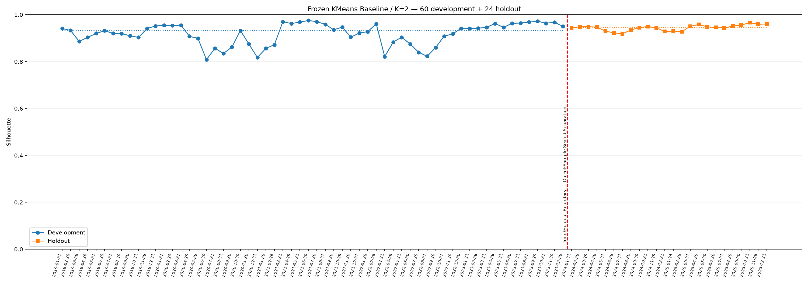

# Báo cáo Nhiệm vụ 11 — Final Holdout V2

<!-- M2_FINAL_HOLDOUT_V2_FULL_REPORT -->

**Ngày biên soạn:** 22/10/2026. **Phạm vi:** kiểm định ngoài mẫu cho duy nhất
KMeans Baseline/K=2 đã được chọn ở Nhiệm vụ 10 V2. Báo cáo giữ bố cục A/B/C của
mẫu Nhiệm vụ 11 cũ; toàn bộ số liệu lấy từ lần chạy V2 đã hoàn tất.

## A — Gate và thực thi một chiều

### 1. Mục tiêu và phương pháp đã đóng băng

Nhiệm vụ 11 kiểm tra sự duy trì cấu trúc phân cụm trên 24 snapshot ngoài mẫu
2024–2025 sau giai đoạn development 60 tháng 2019–2023. Phương án duy nhất là
**KMeans_Baseline, scikit-learn, Global K=2**, theo
[quyết định Task 10 V2](../artifacts/m2-evaluation-v2/final_method_decision.json)
trạng thái `FROZEN_FOR_HOLDOUT`. Ward và PCA + K-Means không được chạy lại trên holdout.

Đóng băng ở đây là giữ thuật toán, tập feature, preprocessing và siêu tham số.
Theo protocol phân cụm độc lập từng tháng, mỗi snapshot holdout được fit Robust
Scaler và K-Means riêng trên cross-section của chính tháng đó; không lấy scaler
hoặc centroids development để áp cho toàn bộ holdout. Giữ seed=42, n_init=10,
max_iter=300, không quét K, không impute/clipping và không chọn lại phương án.

Tám feature gốc: `mom_21`, `mom_63`, `mom_126`, `mom_252`, `vol_63`, `mdd_126`,
`beta_126`, `liquidity_21`. Universe được lọc theo
`market_feature_ready_v2(t)` của từng snapshot; không áp danh sách tháng cuối
ngược lại các tháng trước.

### 2. Bằng chứng thực thi

| Hạng mục | Kết quả thực tế |
| --- | --- |
| Phương án duy nhất | KMeans_Baseline / scikit-learn |
| Global K / seed / n_init / max_iter | 2 / 42 / 10 / 300 |
| Development | 60 tháng: 2019-01-31 → 2023-12-29 |
| Holdout | 24 tháng: 2024-01-31 → 2025-12-31 |
| Quyết định đóng băng (UTC+7) | 21/10/2026 23:42:25 |
| Mở holdout (UTC+7) | 22/10/2026 00:31:03 |
| Hoàn tất (UTC+7) | 22/10/2026 00:32:19 |
| Snapshot hợp lệ / bỏ qua | 24 / 0 |
| Universe thực tế | 959–1410 mã/tháng; trung bình 1171.25 |
| Ngưỡng universe theo kế hoạch | Ít nhất 100 mã; eligibility riêng từng snapshot |
| Assignments / Profiles / Models | 28110 / 48 / 24 |
| Cặp thời gian / Transition rows / Drift rows | 23 / 92 / 368 |
| Scaler parameters | 192 dòng: 24 tháng × 8 feature |
| Feature version / Data version | 1.6.0 / CAFEF_C8_COMPLETE_ONLY_V2 |
| Packages | numpy 2.3.4; scikit-learn 1.9.1; matplotlib 3.11.2 |
| Manifest | complete; synthetic=false; portfolio_evaluation_enabled=false |

Thời điểm quyết định đóng băng đứng trước thời điểm mở holdout. Gate đã kiểm tra
60 selected models/checksum và các input development được pin. Sau thực thi,
manifest ghi `methods_executed=['kmeans']`, `k_values_executed=[2]`; mọi snapshot
hội tụ và không có tháng nào dưới ngưỡng 100 mã. Tổng 28.110 assignments là số
lượt cổ phiếu–snapshot, không phải số cổ phiếu riêng biệt.

Nguồn là C8 Feature Store 1.6.0, `cafef-c8-complete-only-v2`; feature SHA-256:
`414ed8102b1b18039eb35aa07615d55353941b641feeea60106fb3d120cac131`.
Không sửa nguồn C8 hoặc dựng lại feature store khi biên soạn báo cáo này.

### 3. Ranh giới Development/Holdout

Development kết thúc 2023-12-29, holdout bắt đầu 2024-01-31. Dù lịch liên tục,
chuỗi nhãn holdout được bắt đầu mới: **không có transition từ 2023-12-29 sang
2024-01-31**. Chỉ tính đúng 23 cặp nội bộ holdout, từ 2024-01-31 → 2024-02-29
đến 2025-11-28 → 2025-12-31. Quy tắc reset qua tháng thiếu/skip vẫn được giữ;
trong lần chạy này không có gap nội bộ hoặc skip.

## B — Development so với Holdout

### 1. Khoảng cách tổng quát hóa thực tế

| Metric | Số quan sát Dev | Số quan sát Holdout | Median Dev | Median Holdout | Holdout − Dev |
| --- | --- | --- | --- | --- | --- |
| silhouette | 60 | 24 | 0.931935 | 0.945927 | 0.013992 |
| davies_bouldin | 60 | 24 | 0.396416 | 0.399988 | 0.003572 |
| calinski_harabasz | 60 | 24 | 1122.325007 | 3191.392380 | 2069.067373 |
| inertia | 60 | 24 | 82143.837336 | 1290877.594618 | 1208733.757282 |
| cluster_balance | 60 | 24 | 0.023814 | 0.024941 | 0.001128 |
| ari | 59 | 23 | 0.768741 | 0.849616 | 0.080874 |
| nmi | 59 | 23 | 0.624996 | 0.723712 | 0.098715 |
| Persistence (%) | 59 | 23 | 98.931298 | 99.358974 | 0.427677 |
| Migration (%) | 59 | 23 | 1.068702 | 0.641026 | -0.427677 |

Hai hàng Persistence/Migration dùng đơn vị %, nên cột chênh lệch tương ứng là
**điểm phần trăm**; các hàng khác giữ đơn vị gốc. Chất lượng dùng 60/24 snapshot,
temporal dùng 59/23 cặp nội bộ, không trộn số quan sát giữa hai lớp metric.

`Delta_Silhouette = 0.945927159 − 0.931935036 = +0.013992123`.

Median Silhouette tăng **0.013992**, nằm trong trường hợp Delta ≥ −0.05 của
rubric kế hoạch. Đây là bằng chứng mô tả rằng độ phân tách hình học trong mẫu
holdout này không suy giảm theo chỉ số đó. Nó không tự chứng minh không overfit,
khả năng dự báo, sự bền vững ở mọi giai đoạn tương lai hoặc hiệu quả đầu tư.

Các chỉ số không đồng loạt cải thiện: DB tăng từ **0.396416 lên 0.399988**,
trong khi DB thấp hơn mới thuận lợi. CH tăng đáng kể, nhưng CH và Inertia còn
chịu ảnh hưởng quy mô mẫu/độ phân tán. Universe holdout 959–1410 mã lớn hơn
development 116–955 mã; không dùng chênh lệch Inertia tuyệt đối để kết luận
holdout kém hơn hoặc quy toàn bộ thay đổi CH cho chất lượng mô hình.

### 2. Thống kê chất lượng holdout

| metric | n_total | n_available | mean | median | minimum | maximum |
| --- | --- | --- | --- | --- | --- | --- |
| silhouette | 24 | 24 | 0.943793 | 0.945927 | 0.918441 | 0.965754 |
| davies_bouldin | 24 | 24 | 0.398003 | 0.399988 | 0.321662 | 0.466080 |
| calinski_harabasz | 24 | 24 | 3229.154238 | 3191.392380 | 2139.897385 | 4884.204850 |
| inertia | 24 | 24 | 1560523.740371 | 1290877.594618 | 481314.911060 | 4652227.946642 |
| cluster_balance | 24 | 24 | 0.025170 | 0.024941 | 0.017572 | 0.041456 |

Silhouette nằm trong khoảng **0.918441–0.965754**: thấp nhất tại 2024-07-31,
cao nhất tại 2025-10-31. Cả 24 tháng đều vượt 0.70 theo rubric mô tả.
Tuy nhiên **24/24 tháng Balance <0.05**; median Balance chỉ **0.024941**.
Kích thước cụm nhỏ là **22–41 mã**, median 28 mã; nhóm lớn có 929–1384 mã.
Không có singleton, nhưng cấu trúc vẫn rất bất đối xứng. Balance là min_size/max_size,
khác tỷ trọng cụm nhỏ trên tổng số mã.

### 3. Chi tiết 24 snapshot

| Snapshot | Số mã | Cụm nhỏ (mã) | Silhouette | DB | Balance |
| --- | --- | --- | --- | --- | --- |
| 2024-01-31 | 959 | 29 | 0.943272 | 0.415619 | 0.031183 |
| 2024-02-29 | 959 | 30 | 0.948357 | 0.341653 | 0.032293 |
| 2024-03-29 | 960 | 23 | 0.948421 | 0.343113 | 0.024546 |
| 2024-04-26 | 979 | 25 | 0.946805 | 0.366572 | 0.026205 |
| 2024-05-31 | 997 | 31 | 0.929631 | 0.389951 | 0.032091 |
| 2024-06-28 | 1018 | 29 | 0.922272 | 0.460873 | 0.029323 |
| 2024-07-31 | 1030 | 41 | 0.918441 | 0.406451 | 0.041456 |
| 2024-08-30 | 1045 | 34 | 0.934871 | 0.442647 | 0.033630 |
| 2024-09-30 | 1054 | 28 | 0.944607 | 0.350603 | 0.027290 |
| 2024-10-31 | 1056 | 22 | 0.949438 | 0.408338 | 0.021277 |
| 2024-11-29 | 1249 | 25 | 0.943247 | 0.465561 | 0.020425 |
| 2024-12-31 | 1258 | 29 | 0.928290 | 0.466080 | 0.023596 |
| 2025-01-24 | 1265 | 33 | 0.929776 | 0.450199 | 0.026786 |
| 2025-02-28 | 1270 | 32 | 0.927461 | 0.419988 | 0.025848 |
| 2025-03-31 | 1272 | 22 | 0.950482 | 0.335645 | 0.017600 |
| 2025-04-29 | 1274 | 22 | 0.957658 | 0.381185 | 0.017572 |
| 2025-05-30 | 1280 | 28 | 0.948166 | 0.412506 | 0.022364 |
| 2025-06-30 | 1287 | 25 | 0.945049 | 0.321662 | 0.019810 |
| 2025-07-31 | 1292 | 35 | 0.943432 | 0.393525 | 0.027844 |
| 2025-08-29 | 1295 | 32 | 0.950974 | 0.441641 | 0.025337 |
| 2025-09-30 | 1299 | 26 | 0.955474 | 0.461795 | 0.020424 |
| 2025-10-31 | 1301 | 23 | 0.965754 | 0.346961 | 0.017997 |
| 2025-11-28 | 1301 | 26 | 0.958927 | 0.377532 | 0.020392 |
| 2025-12-31 | 1410 | 26 | 0.960220 | 0.351963 | 0.018786 |

Median Balance nhích lên so với development (+0.001128), song không đủ để gọi
hai nhóm cân bằng. Silhouette cao phải được đọc cùng kích thước cụm và đặc
trưng phân tách; không bỏ cảnh báo vì nhóm nhỏ đã lớn hơn một vài mã.

### 4. Quỹ đạo Development/Holdout trên 84 mốc

Hai chuỗi được vẽ riêng, có hai median và đường đỏ đứt tại ranh giới ngoài mẫu.
Không nối đường development với holdout. Biểu đồ cho thấy quỹ đạo chất lượng
quan sát được; nó không phải đồ thị lợi nhuận hoặc kiểm định nhân quả thị trường.

### 5. Temporal stability trong holdout

| Metric | Pairs | Mean | Median | Minimum | Maximum |
| --- | --- | --- | --- | --- | --- |
| ARI | 23 | 0.842394 | 0.849616 | 0.722512 | 0.944378 |
| NMI | 23 | 0.719391 | 0.723712 | 0.541883 | 0.871650 |
| Persistence (%) | 23 | 99.262026 | 99.358974 | 98.153547 | 99.686848 |
| Migration (%) | 23 | 0.737974 | 0.641026 | 0.313152 | 1.846453 |

Median ARI **0.849616**, tăng 0.080874 so với development; NMI median
**0.723712**. Cả **23/23 cặp ARI >0.70**, không có cặp dưới 0.50.
ARI thấp nhất **0.722512** tại **2024-07-31 → 2024-08-30**.
Kết quả ủng hộ sự bền phân hoạch tương đối trên phần universe chung trong mẫu
đã kiểm tra, không đồng nghĩa mọi thành viên hoặc toàn bộ universe bất biến.

Persistence median **99.358974%**, Migration median **0.641026%**. Ma trận
chuyển tích lũy giúp thấy khác biệt giữa nhóm nhỏ và nhóm lớn:

| Từ cụm | Sang cụm | Số lượt | Mẫu số cụm xuất phát | Rate (%) |
| --- | --- | --- | --- | --- |
| 0 | 0 | 548 | 649 | 84.4376 |
| 0 | 1 | 101 | 649 | 15.5624 |
| 1 | 0 | 92 | 26015 | 0.3536 |
| 1 | 1 | 25923 | 26015 | 99.6464 |

Cụm 0 là nhóm nhỏ trong chuỗi holdout này; tỷ lệ giữ gộp là **84.4376%**,
chuyển sang Cụm 1 **15.5624%**, trên 649 lượt xuất phát.
Cụm 1 giữ **99.6464%** trên 26015 lượt. Đây là tỷ lệ theo
lượt cổ phiếu–cặp tháng, không phải số mã riêng biệt hoặc trung bình các rate
tháng. Persistence toàn mẫu bị nhóm lớn chi phối, nên không dùng median gần
99.36% để mô tả riêng độ bám nhãn của nhóm nhỏ.

### 6. Entry/Exit và ý nghĩa cho giao dịch

Tổng 23 cặp có **487 lượt vào, 36 lượt ra**; số mã chung từ 958 đến 1300.
Với quy ước `100 × (Entry + Exit) / n_common`, median thay đổi universe là
**0.703675%**, cao nhất **18.276515%** tại
**2024-10-31 → 2024-11-29**: 193 lượt vào, 0 lượt ra, 1056 mã chung.
Đây là thay đổi membership/eligibility, chưa đủ để kết luận niêm yết/hủy niêm yết.

Migration chỉ đo đổi nhãn của mã chung. Nó và Entry/Exit đều chưa phải portfolio
turnover; chi phí thực còn phụ thuộc vốn, trọng số, tái cân bằng và thực thi.
Không suy thuế/phí/slippage thấp hoặc khả năng bảo toàn lợi nhuận từ Migration.

## C — Hồ sơ cụm, kiểm chứng và giới hạn

### 1. So sánh tám feature gốc theo vai trò

`profile_consistency.csv` xếp hai hồ sơ mỗi tháng thành **Higher_mom63** và
**Lower_mom63** theo mean mom_63 của chính tháng đó. Đây là vai trò tương đối,
không phải nhãn đầu tư hoặc hai tập cổ phiếu cố định; không đồng nhất trực tiếp
với aligned C0/C1 qua ranh giới Dev/Holdout.

Các thống kê dưới đây tổng hợp không trọng số qua mean hồ sơ tháng: 60 tháng
development và 24 tháng holdout cho mỗi vai trò. Không phải mean/median của
mọi cổ phiếu gộp lại. Thanh khoản đổi sang tỷ VND/phiên; momentum, volatility,
MDD và beta giữ thang gốc. Vol_63 đã annualize; MDD âm hơn là drawdown sâu hơn.

**Mean qua hồ sơ tháng:**

| Feature | Higher mom63 Dev | Higher mom63 Holdout | Lower mom63 Dev | Lower mom63 Holdout |
| --- | --- | --- | --- | --- |
| mom_21 | 0.046239 | 0.036617 | 0.011683 | 0.011783 |
| mom_63 | 0.267779 | 0.131048 | 0.037829 | 0.034560 |
| mom_126 | 0.483932 | 0.182279 | 0.127664 | 0.109478 |
| mom_252 | 0.625512 | 0.295601 | 0.286994 | 0.242701 |
| vol_63 | 0.471170 | 0.390745 | 0.493977 | 0.402170 |
| mdd_126 | -0.270279 | -0.212414 | -0.283261 | -0.213341 |
| beta_126 | 1.085649 | 0.860597 | 0.681168 | 0.769899 |
| liquidity_21 (tỷ VND/phiên) | 169.392821 | 331.659360 | 85.747618 | 160.445105 |

**Median qua hồ sơ tháng:**

| Feature | Higher mom63 Dev | Higher mom63 Holdout | Lower mom63 Dev | Lower mom63 Holdout |
| --- | --- | --- | --- | --- |
| mom_21 | 0.031745 | 0.026968 | 0.012441 | 0.007790 |
| mom_63 | 0.095519 | 0.098798 | 0.038119 | 0.020418 |
| mom_126 | 0.091339 | 0.114806 | 0.079312 | 0.076536 |
| mom_252 | 0.109116 | 0.190703 | 0.133167 | 0.171424 |
| vol_63 | 0.470226 | 0.418400 | 0.507213 | 0.440522 |
| mdd_126 | -0.252482 | -0.216165 | -0.254271 | -0.223663 |
| beta_126 | 1.114736 | 1.111992 | 0.423503 | 0.540529 |
| liquidity_21 (tỷ VND/phiên) | 104.831699 | 326.510262 | 6.576262 | 11.161228 |

Mean mom_63 của vai trò Higher giảm từ **0.267779 xuống 0.131048**; nhưng
median tăng nhẹ từ **0.095519 lên 0.098798**. Vì vậy không diễn giải riêng mức
giảm mean thành suy yếu đồng đều ở mọi tháng hoặc mọi mã. Mean volatility của
cả hai vai trò giảm và MDD mean bớt âm; đây là mô tả mẫu theo các chỉ số đã lưu,
không tự chứng minh một cơ chế vĩ mô hoặc mức an toàn của danh mục.

Mean thanh khoản Higher/Lower tăng từ **169.392821/85.747618** lên
**331.659360/160.445105 tỷ VND/phiên**. Vai trò Higher_mom63 có thanh khoản
cao hơn Lower_mom63 ở **14/24** tháng holdout (development:
40/60), nên không mặc định “momentum cao” luôn đồng nghĩa “thanh khoản lớn”.
Thứ tự mom_63 giữa hai vai trò là cách đặt vai trò, không phải bằng chứng độc lập
về khả năng dẫn dắt thị trường.

### 2. Vì sao vẫn phải giữ cảnh báo phân tách theo thanh khoản?

Phân rã bình phương khoảng cách hai centroids đã lưu trong không gian Robust
Scaling theo từng feature, không fit lại model:

`share_f = (centroid_0[f] − centroid_1[f])² / sum_g((centroid_0[g] − centroid_1[g])²)`.

Thanh khoản đứng đầu tỷ trọng này ở **24/24 tháng**: median
**99.997397%**, min–max **99.992713–99.999416%**.
Kết quả phù hợp với phân tách hình học chủ yếu theo thanh khoản trong mẫu này;
cần đọc Silhouette cao cùng mức bất đối xứng nêu ở phần B.
Đây không phải PCA explained variance, tỷ lệ đóng góp lợi nhuận, feature importance
của mô hình dự báo hoặc bằng chứng dòng tiền là nguyên nhân nhân quả.

Mean thanh khoản cụm không đủ xác nhận sức chứa vốn hay chi phí thực thi từng
mã; M3 cần dữ liệu thành viên, vốn, trọng số và mô hình giao dịch. Không quy kết
đảo chiều hồ sơ cho VN-Index khi báo cáo chưa đối chiếu chuỗi chỉ số tương ứng.

### 3. Phán quyết và bàn giao

Nhiệm vụ 11 V2 **hoàn tất về thực thi và tính toàn vẹn đầu ra**: 24 model,
28.110 assignments, 48 hồ sơ, 23 cặp tháng, 92 transition rows, 368 drift rows,
192 scaler rows, bảng gap/hồ sơ, biểu đồ 84 mốc, source snapshot và manifest.
Độ phân tách và tương đồng phân hoạch trong holdout không suy giảm theo median
Silhouette/ARI quan sát được; vẫn giữ cảnh báo Balance dưới 0.05 ở mọi tháng
và chuyển nhãn của nhóm nhỏ khác rõ nhóm lớn.

Giữ nguyên phương pháp sau holdout; không quay lại chọn K, retune scaler/PCA,
chạy comparator hoặc đổi thuật toán dựa vào các kết quả này. Đây là monthly
independent clustering market-only, không phải Dynamic Clustering, strict
historical research universe hoặc bằng chứng hiệu quả đầu tư.

Bàn giao cho Task 12 để kiểm toán input/output, ranh giới và freeze; M3 chỉ
tiếp tục theo methodology/gates của giai đoạn đó. Báo cáo này không tự đánh dấu
Task 12/M3 hoàn tất hoặc thay kết quả holdout bằng kịch bản giả định.

## Cách mở, kiểm chứng và chạy lại

- Mở [Notebook 11 V2](../notebooks/11_final_holdout_execution_v2.ipynb), dùng kernel
  Python đã chạy M2. Bộ kết quả hiện tại đã `complete`; chạy lại chỉ xác minh
  checksum và nạp artifacts, không fit lại hoặc mở một lần thử mới.
- Nếu input, code hoặc checksum không khớp, giữ evidence và kiểm tra nguyên nhân;
  không xóa kết quả rồi chạy lại để chọn một kết luận thuận lợi hơn.
- Báo cáo được mở rộng từ số liệu đã lưu. Bản xuất tự động ban đầu được giữ
  tại `report_auto.md` trong artifact directory; chỉ cập nhật nội dung báo cáo
  và metadata checksum tương ứng, không sửa numerical artifacts/model/code.

## Nguồn đối chiếu

- [Kế hoạch M2, phần 11](../Ke_hoach_M2_Phan_cum_co_phieu.md).
- [Mẫu bố cục báo cáo Nhiệm vụ 11 cũ trong runner V1](../../src/delta_t1/experiments/final_holdout.py).
- [Config holdout V2](../../configs/experiments/m2_final_holdout_v2.json).
- [Manifest holdout V2](../artifacts/m2-final-holdout-v2/manifest.json).
- [Validation](../artifacts/m2-final-holdout-v2/snapshot_validation.csv),
  [diagnostics](../artifacts/m2-final-holdout-v2/diagnostics.csv),
  [quality summary](../artifacts/m2-final-holdout-v2/quality_summary.csv).
- [Generalization gap](../artifacts/m2-final-holdout-v2/holdout_generalization_gap.csv),
  [profile consistency](../artifacts/m2-final-holdout-v2/profile_consistency.csv).
- [Temporal stability](../artifacts/m2-final-holdout-v2/temporal_stability.csv),
  [transition matrices](../artifacts/m2-final-holdout-v2/transition_matrices.csv),
  [centroid drift](../artifacts/m2-final-holdout-v2/centroid_drift.csv).
- [24 model/scaler holdout](../models/holdout_v2/).
