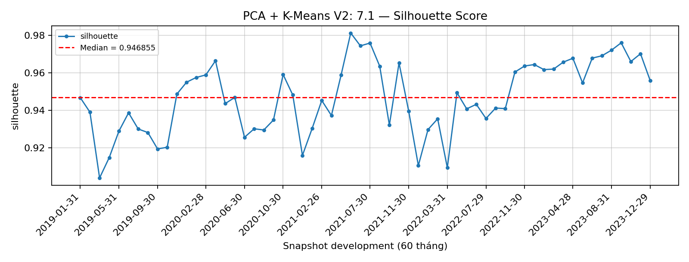
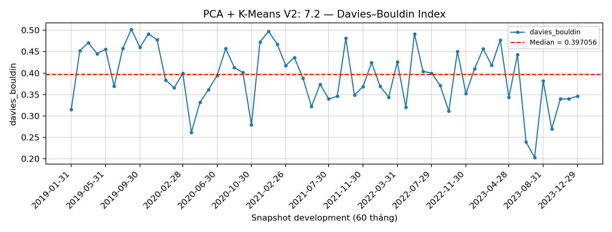
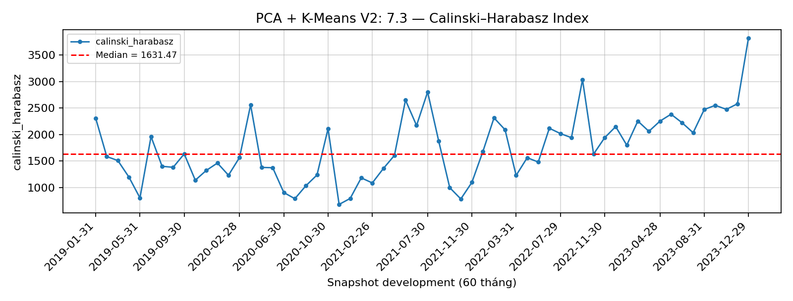
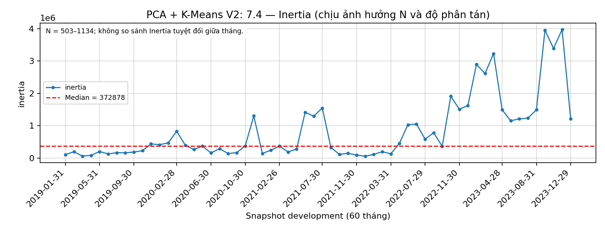
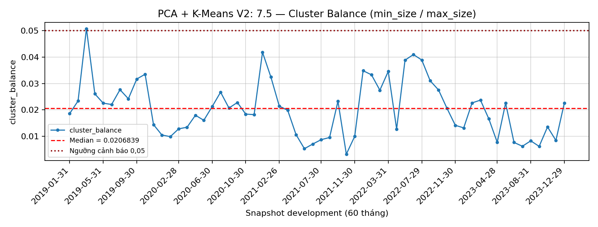

# Báo cáo Nhiệm vụ 7 — Đánh giá chất lượng cụm PCA + K-Means với dữ liệu mới V2

<!-- PCA_KMEANS_V2_FULL_REPORT -->

**Ngày biên soạn:** 21/10/2026. **Phạm vi:** 60 snapshot development từ
2019-01-31 đến 2023-12-29; Global K=2; PCA 2 chiều.

Bản báo cáo này phát triển bố cục A/B/C, bảng số liệu và cách biện luận của mẫu
PCA + K-Means cũ trong lịch sử Git, sử dụng hoàn toàn kết quả V2 đã lưu.
**Cập nhật báo cáo và đồng bộ Git:** 22/10/2026. Bản đầy đủ này thay bản
xuất tự động ở đường dẫn báo cáo chính. Bản trước được giữ trong Git history;
checksum báo cáo và tham chiếu manifest được cập nhật, model/số liệu gốc
giữ nguyên. Số liệu trong bảng dùng dấu chấm thập phân; giá trị trình bày
được làm tròn, dữ liệu nguồn giữ độ chính xác gốc.

## A — Phán quyết kỹ thuật

### 1. Mục tiêu và cách lấy mẫu đánh giá

Nhiệm vụ 7 đọc `diagnostics.csv` của Nhiệm vụ 6, lọc Global K=2, kiểm tra đúng
60 ngày development và tổng hợp năm chỉ số đã tính. Không fit lại model và
không gộp 420 chẩn đoán của nhiều K thành mẫu chất lượng của phương án K=2.
Mọi chỉ số hình học ở đây được đo trong **không gian PCA 2 chiều** dùng để clustering.

Silhouette là chỉ số chính; Davies–Bouldin dùng xác nhận/đối chiếu; CH và Balance
là kiểm tra bổ sung. Inertia mô tả tổng khoảng cách bình phương trong không gian
đó. Balance được tính bằng kích thước cụm nhỏ chia kích thước cụm lớn, khác với
tỷ trọng cụm nhỏ trên tổng số mã.

### 2. Bảng 1 — Tóm tắt năm chỉ số

| metric | n_total | n_available | mean | median | minimum | maximum |
| --- | --- | --- | --- | --- | --- | --- |
| silhouette | 60 | 60 | 0.946822 | 0.946855 | 0.903889 | 0.981342 |
| davies_bouldin | 60 | 60 | 0.392388 | 0.397056 | 0.203106 | 0.502464 |
| calinski_harabasz | 60 | 60 | 1750.124284 | 1631.466715 | 679.358341 | 3823.662000 |
| inertia | 60 | 60 | 848455.026434 | 372878.404927 | 56117.361311 | 3969503.000000 |
| cluster_balance | 60 | 60 | 0.020535 | 0.020684 | 0.003252 | 0.050794 |

Mọi chỉ số có đủ 60/60 giá trị. Median Silhouette **0.946855** vượt ngưỡng mô tả
0.70 của kế hoạch; cả 60/60 tháng đều vượt ngưỡng này. DB median 0.397056 cùng CH median
1631.466715 củng cố nhận định rằng hai nhóm tách biệt rõ về hình học trong không
gian PCA đã chọn. Các ngưỡng này là rubric mô tả, không phải kiểm định thống kê.

### 3. Bảng 2 — Chi tiết chất lượng 60 tháng

| Snapshot | Silhouette | DB | CH | Inertia | Balance |
| --- | --- | --- | --- | --- | --- |
| 2019-01-31 | 0.946776 | 0.315575 | 2305.684046 | 107060.745732 | 0.018634 |
| 2019-02-28 | 0.939040 | 0.452440 | 1583.082311 | 194138.527792 | 0.023401 |
| 2019-03-29 | 0.903889 | 0.470727 | 1507.588679 | 59187.649529 | 0.050794 |
| 2019-04-26 | 0.914797 | 0.445497 | 1196.109156 | 85063.764591 | 0.026074 |
| 2019-05-31 | 0.928886 | 0.455470 | 802.254096 | 201677.583282 | 0.022556 |
| 2019-06-28 | 0.938682 | 0.369276 | 1960.429966 | 128016.035484 | 0.022059 |
| 2019-07-31 | 0.930036 | 0.457128 | 1398.695609 | 166062.419030 | 0.027656 |
| 2019-08-30 | 0.928143 | 0.502464 | 1380.344654 | 161992.626535 | 0.024226 |
| 2019-09-30 | 0.919389 | 0.460047 | 1633.274143 | 186278.492390 | 0.031704 |
| 2019-10-31 | 0.920277 | 0.491523 | 1136.799833 | 226591.436415 | 0.033512 |
| 2019-11-29 | 0.948681 | 0.477762 | 1322.040765 | 437936.758945 | 0.014436 |
| 2019-12-31 | 0.955021 | 0.383821 | 1460.472383 | 412283.562380 | 0.010511 |
| 2020-01-31 | 0.957578 | 0.365920 | 1230.683872 | 469536.932937 | 0.009885 |
| 2020-02-28 | 0.958936 | 0.399368 | 1565.558849 | 825610.459970 | 0.012841 |
| 2020-03-31 | 0.958375 | 0.282651 | 1795.736679 | 104931.077915 | 0.014344 |
| 2020-04-29 | 0.918394 | 0.454852 | 1026.212333 | 59557.105493 | 0.034169 |
| 2020-05-29 | 0.911723 | 0.458693 | 993.484465 | 55172.988395 | 0.031891 |
| 2020-06-30 | 0.851754 | 0.481715 | 867.356507 | 9940.355776 | 0.069333 |
| 2020-07-31 | 0.881254 | 0.339072 | 879.651894 | 18802.299796 | 0.041344 |
| 2020-08-31 | 0.864785 | 0.486652 | 862.139102 | 12482.055990 | 0.060526 |
| 2020-09-30 | 0.891599 | 0.399335 | 911.320399 | 15042.598041 | 0.034121 |
| 2020-10-30 | 0.940443 | 0.229601 | 1558.403724 | 47971.641840 | 0.023316 |
| 2020-11-30 | 0.892889 | 0.392217 | 986.908162 | 16290.607417 | 0.053512 |
| 2020-12-31 | 0.856592 | 0.439892 | 868.198226 | 6287.715767 | 0.061584 |
| 2021-01-29 | 0.881837 | 0.403326 | 1103.148437 | 15188.077643 | 0.051454 |
| 2021-02-26 | 0.892527 | 0.380961 | 1204.561813 | 15201.846954 | 0.052493 |
| 2021-03-31 | 0.973455 | 0.256148 | 1673.668805 | 33097.889676 | 0.011583 |
| 2021-04-29 | 0.966303 | 0.276833 | 1104.391316 | 50981.295681 | 0.011111 |
| 2021-05-31 | 0.971930 | 0.313731 | 1289.894270 | 48220.297402 | 0.012146 |
| 2021-06-30 | 0.977565 | 0.176945 | 1992.421870 | 106881.163062 | 0.009404 |
| 2021-07-30 | 0.973435 | 0.270453 | 1857.244208 | 83815.725082 | 0.013029 |
| 2021-08-31 | 0.963236 | 0.238250 | 1089.011875 | 38513.885317 | 0.012605 |
| 2021-09-30 | 0.944850 | 0.244463 | 770.905659 | 8535.061427 | 0.018405 |
| 2021-10-29 | 0.953219 | 0.029910 | 452.034856 | 7624.042832 | 0.006944 |
| 2021-11-30 | 0.910207 | 0.521108 | 313.585385 | 31776.710215 | 0.042169 |
| 2021-12-31 | 0.937225 | 0.185450 | 485.958563 | 1721.696524 | 0.017544 |
| 2022-01-28 | 0.941265 | 0.034221 | 279.009572 | 2590.583532 | 0.008696 |
| 2022-02-28 | 0.966176 | 0.019136 | 601.274261 | 15795.445282 | 0.006452 |
| 2022-03-31 | 0.858214 | 0.415486 | 389.023150 | 6209.580699 | 0.039841 |
| 2022-04-29 | 0.901194 | 0.342313 | 529.574274 | 11560.726906 | 0.028455 |
| 2022-05-31 | 0.915436 | 0.345984 | 555.441201 | 25566.736494 | 0.022989 |
| 2022-06-30 | 0.886017 | 0.486091 | 588.395813 | 46361.384369 | 0.067460 |
| 2022-07-29 | 0.866199 | 0.528348 | 476.094896 | 10399.884911 | 0.062500 |
| 2022-08-31 | 0.859441 | 0.490357 | 511.604523 | 5332.517215 | 0.051793 |
| 2022-09-30 | 0.882287 | 0.378753 | 798.714530 | 6717.928162 | 0.039867 |
| 2022-10-31 | 0.915410 | 0.465096 | 647.724808 | 91674.878818 | 0.038567 |
| 2022-11-30 | 0.923260 | 0.373364 | 800.279692 | 78232.185712 | 0.033898 |
| 2022-12-30 | 0.944794 | 0.407807 | 1165.270027 | 204789.139282 | 0.019397 |
| 2023-01-31 | 0.943070 | 0.488557 | 1004.094846 | 973817.124390 | 0.035775 |
| 2023-02-28 | 0.945490 | 0.412371 | 1270.490135 | 654363.834504 | 0.025424 |
| 2023-03-31 | 0.949022 | 0.504340 | 1188.837667 | 839270.743627 | 0.025295 |
| 2023-04-28 | 0.964018 | 0.345880 | 1953.133496 | 1177937.713614 | 0.009009 |
| 2023-05-31 | 0.949490 | 0.445308 | 2051.742874 | 762003.252851 | 0.026498 |
| 2023-06-30 | 0.965252 | 0.241123 | 2051.171871 | 780842.722746 | 0.008343 |
| 2023-07-31 | 0.966418 | 0.204891 | 1883.077280 | 674321.281055 | 0.006749 |
| 2023-08-31 | 0.969976 | 0.383379 | 2284.566742 | 1125955.714331 | 0.008979 |
| 2023-09-29 | 0.972964 | 0.271491 | 2166.383062 | 3746647.752494 | 0.008333 |
| 2023-10-31 | 0.964462 | 0.317463 | 2034.144094 | 3046888.456293 | 0.014013 |
| 2023-11-30 | 0.968223 | 0.370663 | 2073.051106 | 5012763.856157 | 0.008999 |
| 2023-12-29 | 0.952717 | 0.352511 | 3344.686355 | 946476.681288 | 0.025779 |

### 4. Cảnh báo cụm nhỏ và chỉ số đẹp

Median Balance là **0.023814**; có **50/60 tháng Balance <0.05** và toàn bộ
60 tháng dưới 0.10. Không có tháng đạt Balance ≥0.30. Median tỷ trọng cụm nhỏ
trên tổng mẫu là **2.3259%**; hai đại lượng không được dùng thay nhau.
Cụm nhỏ có 1–32 mã; ba tháng singleton cần được giữ trong diễn giải:

| Snapshot | Cụm nhỏ (mã) | Tổng số mã | Silhouette | DB | Balance |
| --- | --- | --- | --- | --- | --- |
| 2021-10-29 | 1 | 145 | 0.953219 | 0.029910 | 0.006944 |
| 2022-01-28 | 1 | 116 | 0.941265 | 0.034221 | 0.008696 |
| 2022-02-28 | 1 | 156 | 0.966176 | 0.019136 | 0.006452 |

Đặc biệt, DB thấp nhất 0.019136 tại 2022-02-28 đi cùng cấu trúc 1/155 mã.
Một điểm tách rất xa có thể làm chỉ số phân tách thuận lợi, trong khi cụm nhỏ
không đại diện cho một nhóm rộng. Vì vậy không dùng riêng Silhouette/DB để bỏ
qua mức mất cân bằng hoặc kết luận phương án phù hợp cho mọi mục đích.

Inertia từ 1721.696524 đến 5012763.856157; mean 411599.887633 cao hơn median
81023.955397. Universe thay đổi 116–955 mã, đồng thời độ phân tán sau Robust
Scaling thay đổi, nên Inertia tuyệt đối không phải thước đo độc lập để xếp hạng
các tháng hoặc kết luận tháng Inertia lớn là tháng phân cụm kém.

### 5. Năm biểu đồ chất lượng

Các đường median và ngưỡng Balance giúp đọc mức điển hình cùng các tháng lệch.
Đây là biểu đồ chất lượng hình học theo snapshot, chưa đo sự giữ/chuyển nhãn.

## B — Bản chất cấu trúc quan sát

Kết hợp phân tách rõ với quy mô rất lệch, cấu trúc phù hợp với mô tả **phân cụm
bất đối xứng/cô lập nhóm ngoại lai** theo rubric của kế hoạch. Bằng chứng hiện tại
không ủng hộ cách gọi hai chế độ thị trường có quy mô cân bằng.

[Nhiệm vụ 8](Bao_cao_M2_Nhiem_vu_8_Ho_so_cum_PCA_KMeans_v2.md) cho thấy cụm nhỏ có thanh khoản bình quân vượt rõ
cụm lớn và `liquidity_21` là đặc trưng có chênh lệch Robust Z lớn nhất ở 60/60 tháng.
Điều này cung cấp mô tả cụ thể cho sự phân tách mà diagnostics một mình không
giải thích được. Nó chưa chứng minh dòng tiền ròng, đầu cơ, nguyên nhân biến động
giá hoặc hành vi giống nhau của toàn bộ cổ phiếu trong cụm.

Protocol không clipping/winsorization, nên phần đuôi cực đoan vẫn hiện diện sau
Robust Scaling. Do đó Silhouette cao cần được đọc cùng loadings, hồ sơ gốc và
kích thước cụm; không đồng nhất tỷ lệ phương sai giữ lại với giá trị kinh tế hoặc
khả năng sinh lợi. Thay đổi chất lượng qua tháng cũng không thay thế chẩn đoán
độ bền nhãn được báo cáo ở Nhiệm vụ 9.

## C — Bàn giao và giới hạn

Nhiệm vụ 7 hoàn tất hai bảng chuẩn, năm biểu đồ và `quality_summary.csv` có
5 dòng × 7 cột. Mỗi dòng có `n_total=n_available=60`; manifest Nhiệm vụ 7
ghi `complete`, `no_refit=true`, `holdout_accessed=false`.

Khi bàn giao Nhiệm vụ 10 cần giữ đồng thời: median Silhouette/DB/CH, cảnh báo
50/60 tháng Balance dưới 0.05 và ba singleton. Chỉ so sánh các phương án cùng
dữ liệu, universe, 60 tháng development, Global K và quy ước đo; ghi rõ khác biệt
không gian PCA 2 chiều với không gian feature gốc. Không so với PCA cũ 15 tháng
để tuyên bố V2 tốt hơn do riêng thay đổi PCA.

Kết quả chứng minh khả năng bàn giao bằng chứng chất lượng của PCA V2, chưa
tuyên bố mô hình chiến thắng. Nhiệm vụ 8–9 V2 đã hoàn tất riêng. Theo
[quyết định Task 10 V2](../artifacts/m2-evaluation-v2/final_method_decision.json)
đã đồng bộ từ Git, **KMeans_Baseline, K=2** được chọn; PCA vẫn là comparator.
Báo cáo Nhiệm vụ 7 không tự thay đổi quyết định đó. Không chọn lại K, mở holdout, backtest hoặc dùng portfolio
return/Sharpe/ROI để quyết định chất lượng cụm.

## Nguồn và khả năng kiểm chứng

- [Kế hoạch M2](../Ke_hoach_M2_Phan_cum_co_phieu.md), phần Nhiệm vụ 7.
- [Notebook thực thi](../notebooks/07_cluster_quality_evaluation_pca_kmeans_v2.ipynb).
- [Diagnostics Nhiệm vụ 6](../artifacts/m2-task6-pca-kmeans-v2/diagnostics.csv).
- [Quality summary](../artifacts/m2-evaluation-pca-kmeans-v2/quality_summary.csv).
- [Manifest Nhiệm vụ 7](../artifacts/m2-evaluation-pca-kmeans-v2/manifest.json).
- [Mẫu báo cáo cũ trong notebook ở commit a436eb8](https://github.com/trongnguyen1010/Risk-Adjusted-Momentum-Clustering/blob/a436eb83214c18219da4a990851b8121df0a3e94/M2/notebooks/07_cluster_quality_evaluation_pca_kmeans.ipynb).

Trước khi biên soạn đã đối chiếu checksum các đầu ra được manifest Nhiệm vụ
6–9 tham chiếu, cấu hình, số dòng và phạm vi ngày. Quá trình viết báo cáo chỉ
đọc kết quả đã lưu; không huấn luyện lại, không sửa model/scaler/PCA và không
truy cập dữ liệu holdout 2024–2025.
