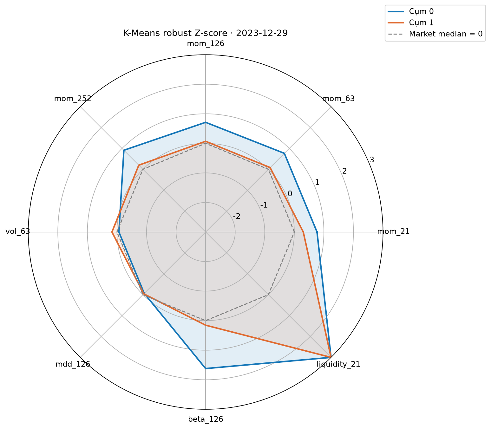
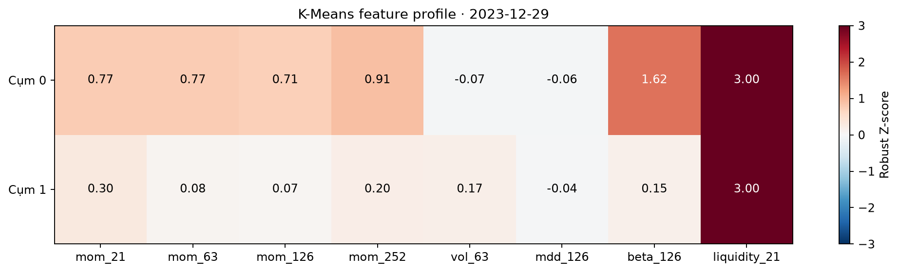

# Báo cáo M2 Nhiệm vụ 8 — Hồ sơ cụm K-Means

## Nguồn và phạm vi

Đọc duy nhất [Task 4 cluster_profiles.csv](../artifacts/m2-task4-kmeans-baseline-v1/cluster_profiles.csv) và scaler đã fit trong `M2/models/kmeans/`. Gồm 60 snapshot phát triển, 2019-01-31 đến 2023-12-29; mỗi tháng có hai cụm. Không fit lại mô hình hay trích xuất feature.

`aligned_cluster_id` là nhãn đã căn chỉnh. Trung bình và trung vị bên dưới tính **theo 60 giá trị hồ sơ tháng của từng cụm**, không gộp cổ phiếu xuyên tháng. Thanh khoản đổi từ VND/phiên sang tỷ VND/phiên.

## Bảng 1 — Hồ sơ theo cụm (4 × 10)

| aligned_cluster_id   |     size |   liquidity_21_ty_vnd |   beta_126 |   vol_63 |   mdd_126 |   mom_21 |   mom_63 |   mom_126 |   mom_252 |
|:---------------------|---------:|----------------------:|-----------:|---------:|----------:|---------:|---------:|----------:|----------:|
| Cụm 0 (Mean)         |  12.1167 |              250.116  |     1.3803 |   0.4557 |   -0.2822 |   0.0401 |   0.2442 |    0.4815 |    0.6585 |
| Cụm 0 (Median)       |  12      |              216.311  |     1.4114 |   0.4466 |   -0.2596 |   0.0282 |   0.0825 |    0.0977 |    0.1109 |
| Cụm 1 (Mean)         | 486.333  |                5.0242 |     0.3865 |   0.5095 |   -0.2713 |   0.0178 |   0.0614 |    0.1301 |    0.254  |
| Cụm 1 (Median)       | 439      |                3.9857 |     0.3764 |   0.512  |   -0.2509 |   0.0138 |   0.0471 |    0.083  |    0.1187 |

## Bảng 2 — Chênh lệch trung bình (9 × 4)

| Đặc trưng           |   Cụm 0 (Mean) |   Cụm 1 (Mean) |   Chênh lệch (Cụm 0 - Cụm 1) |
|:--------------------|---------------:|---------------:|-----------------------------:|
| size                |        12.1167 |       486.333  |                    -474.217  |
| liquidity_21_ty_vnd |       250.116  |         5.0242 |                     245.092  |
| beta_126            |         1.3803 |         0.3865 |                       0.9937 |
| vol_63              |         0.4557 |         0.5095 |                      -0.0538 |
| mdd_126             |        -0.2822 |        -0.2713 |                      -0.0109 |
| mom_21              |         0.0401 |         0.0178 |                       0.0223 |
| mom_63              |         0.2442 |         0.0614 |                       0.1829 |
| mom_126             |         0.4815 |         0.1301 |                       0.3514 |
| mom_252             |         0.6585 |         0.254  |                       0.4045 |

## Bảng 3 — Quy mô và thanh khoản theo tháng (60 × 5)

| Snapshot   |   Size Cụm 0 |   Size Cụm 1 |   Liquidity Cụm 0 (tỷ VND) |   Liquidity Cụm 1 (tỷ VND) |
|:-----------|-------------:|-------------:|---------------------------:|---------------------------:|
| 2019-01-31 |           12 |          644 |                    87.9333 |                     1.6633 |
| 2019-02-28 |           15 |          641 |                   106.754  |                     2.0799 |
| 2019-03-29 |           32 |          630 |                    74.3385 |                     1.7347 |
| 2019-04-26 |           17 |          652 |                    76.1523 |                     2.0044 |
| 2019-05-31 |           15 |          665 |                    88.9821 |                     1.9839 |
| 2019-06-28 |           15 |          680 |                    78.8361 |                     1.6793 |
| 2019-07-31 |           19 |          687 |                    76.4571 |                     1.6189 |
| 2019-08-30 |           18 |          743 |                    79.4675 |                     1.7693 |
| 2019-09-30 |           24 |          757 |                    58.2802 |                     1.4375 |
| 2019-10-31 |           25 |          746 |                    56.2292 |                     1.3437 |
| 2019-11-29 |           11 |          762 |                   102.909  |                     1.872  |
| 2019-12-31 |            7 |          666 |                   111.144  |                     1.8308 |
| 2020-01-31 |            6 |          607 |                   128.065  |                     1.9872 |
| 2020-02-28 |           11 |          620 |                   124.864  |                     1.7355 |
| 2020-03-31 |            7 |          488 |                   163.58   |                     2.5762 |
| 2020-04-29 |           15 |          439 |                    87.2454 |                     2.1234 |
| 2020-05-29 |           14 |          439 |                   113.929  |                     2.9865 |
| 2020-06-30 |           26 |          375 |                    82.2978 |                     2.5521 |
| 2020-07-31 |           16 |          387 |                    78.9356 |                     2.7032 |
| 2020-08-31 |           23 |          380 |                    78.5602 |                     2.4472 |
| 2020-09-30 |           15 |          379 |                   127.625  |                     4.1654 |
| 2020-10-30 |            9 |          386 |                   270.221  |                     5.8463 |
| 2020-11-30 |           16 |          299 |                   152.835  |                     4.4797 |
| 2020-12-31 |           21 |          341 |                   191.092  |                     6.9893 |
| 2021-01-29 |           23 |          447 |                   258.495  |                     7.9129 |
| 2021-02-26 |           20 |          381 |                   251.719  |                     7.5124 |
| 2021-03-31 |            3 |          259 |                   218.295  |                     1.8739 |
| 2021-04-29 |            3 |          270 |                   220.621  |                     2.5351 |
| 2021-05-31 |            3 |          247 |                   203.278  |                     1.6378 |
| 2021-06-30 |            3 |          319 |                   396.915  |                     3.3158 |
| 2021-07-30 |            4 |          307 |                   220.465  |                     1.8851 |
| 2021-08-31 |            3 |          238 |                   309.843  |                     4.0846 |
| 2021-09-30 |            3 |          163 |                   282.574  |                     5.407  |
| 2021-10-29 |            1 |          144 |                   323.421  |                     5.6159 |
| 2021-11-30 |            5 |          168 |                   214.327  |                     5.2508 |
| 2021-12-31 |            2 |          114 |                   389.73   |                     8.5712 |
| 2022-01-28 |            1 |          115 |                   517.143  |                     8.9414 |
| 2022-02-28 |            1 |          155 |                   427.13   |                     4.7126 |
| 2022-03-31 |           10 |          251 |                   537.174  |                    21.1277 |
| 2022-04-29 |            7 |          246 |                   590.673  |                    19.1773 |
| 2022-05-31 |            6 |          261 |                   463.38   |                    13.9143 |
| 2022-06-30 |           17 |          252 |                   244.589  |                     7.4075 |
| 2022-07-29 |           14 |          224 |                   204.456  |                     7.1877 |
| 2022-08-31 |           13 |          251 |                   314.659  |                    11.9161 |
| 2022-09-30 |           12 |          301 |                   276.776  |                     9.8723 |
| 2022-10-31 |           17 |          360 |                   261.514  |                     6.2327 |
| 2022-11-30 |           12 |          354 |                   272.299  |                     6.8612 |
| 2022-12-30 |            9 |          464 |                   360.602  |                     6.7403 |
| 2023-01-31 |           15 |          593 |                   203.793  |                     3.4571 |
| 2023-02-28 |           15 |          590 |                   201.037  |                     3.4368 |
| 2023-03-31 |           15 |          593 |                   196.809  |                     2.8225 |
| 2023-04-28 |            8 |          888 |                   289.144  |                     3.8868 |
| 2023-05-31 |           23 |          868 |                   187.026  |                     2.8221 |
| 2023-06-30 |            7 |          839 |                   465.538  |                     6.3648 |
| 2023-07-31 |            6 |          889 |                   506.654  |                     6.7877 |
| 2023-08-31 |            8 |          891 |                   642.875  |                     6.8811 |
| 2023-09-29 |            6 |          720 |                   769.484  |                     8.0761 |
| 2023-10-31 |           11 |          785 |                   368.53   |                     4.6535 |
| 2023-11-30 |            8 |          889 |                   465.117  |                     5.5669 |
| 2023-12-29 |           24 |          931 |                   354.158  |                     5.3928 |

## Trực quan và diễn giải

Hai hình tĩnh lấy snapshot cuối 2023-12-29. Trong notebook có Dropdown để xem từng tháng. Robust Z-score dùng center/scale của đúng snapshot trong model JSON và chặn hiển thị ở [-3, 3]; đường 0 là median thị trường của scaler.

### A. Chân dung kinh tế

Cụm 0 chiếm trung bình 2.6% số mã mỗi tháng, Cụm 1 chiếm 97.4%. Thanh khoản trung bình lần lượt 250.12 và 5.02 tỷ VND/phiên; đối chiếu dòng Median trong Bảng 1 để thấy độ lệch do tháng cực trị.

### B. Động lực phân tách

Tại 2023-12-29, chênh lệch Robust Z-score tuyệt đối lớn nhất là `beta_126` = 1.47 sau khi chặn [-3, 3]. Đây là đặc trưng tách cụm mạnh nhất trên hình cuối kỳ; kết luận cho toàn kỳ cần đối chiếu chênh lệch 60 tháng ở Bảng 2. Giá trị cắt ngưỡng 3 làm mất thông tin độ lớn ở cực trị.

### C. Ranh giới cho M3

Bảng 3 cho phép kiểm tra quy mô và thanh khoản từng tháng trước khi thiết kế backtest. Hồ sơ trung bình của cụm không chứng minh tính khả thi giao dịch của từng mã hoặc chi phí trượt giá; M2 chưa đưa ra khuyến nghị đầu tư. Mean nhạy với quan sát cực trị, và nhãn cụm có thể đổi thành viên qua thời gian. Không dùng return, Sharpe hay ROI để chọn cụm.

Ba bảng được hiển thị trong `M2/notebooks/08_cluster_profiling_kmeans.ipynb`; hai biểu đồ bàn giao nằm trong `M2/artifacts/m2-evaluation-kmeans/`.
