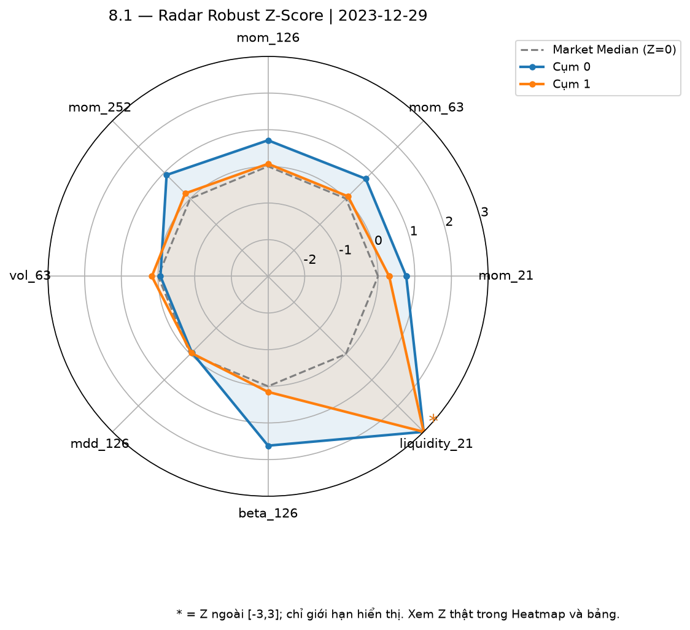
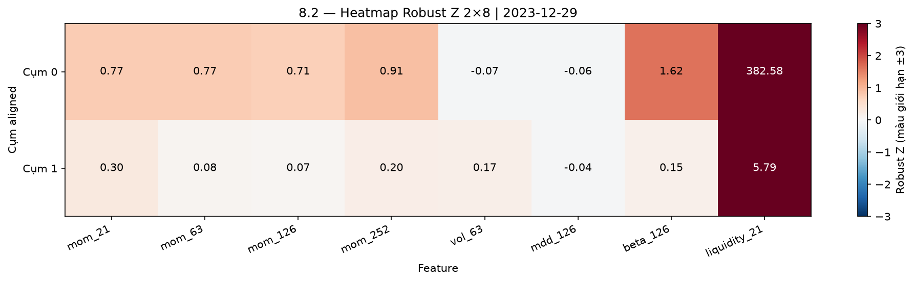

# Báo cáo Nhiệm vụ 8 — Hồ sơ cụm PCA + K-Means V2

Nguồn profile SHA-256: 9dd6b3528faeee871ba63d8168d45661dc706bd51f61f960422243b340d8e564.

60 development snapshots, K=2, 120 hồ sơ trên 8 feature gốc. Đọc scaler đã fit của đúng snapshot; không huấn luyện hoặc inverse PCA lại.

## Bảng 1 — Mean/Median qua tháng

| aligned_cluster_id | size | liquidity_21_ty_vnd | beta_126 | vol_63 | mdd_126 | mom_21 | mom_63 | mom_126 | mom_252 |
| --- | --- | --- | --- | --- | --- | --- | --- | --- | --- |
| Cụm 0 (Mean) | 12.116667 | 249.983935 | 1.377735 | 0.455133 | -0.281996 | 0.038937 | 0.24063 | 0.478703 | 0.65633 |
| Cụm 0 (Median) | 12.0 | 211.375599 | 1.401596 | 0.446606 | -0.264809 | 0.028224 | 0.082456 | 0.098634 | 0.110857 |
| Cụm 1 (Mean) | 486.333333 | 5.01922 | 0.386404 | 0.509499 | -0.271313 | 0.017761 | 0.061301 | 0.130076 | 0.253186 |
| Cụm 1 (Median) | 439.0 | 3.985669 | 0.376399 | 0.511969 | -0.250859 | 0.013843 | 0.047075 | 0.083046 | 0.118693 |

## Bảng 2 — Chênh lệch C0−C1

| Đặc trưng | Cụm 0 (Mean) | Cụm 1 (Mean) | Chênh lệch (Cụm 0 - Cụm 1) |
| --- | --- | --- | --- |
| size | 12.116667 | 486.333333 | -474.216667 |
| liquidity_21_ty_vnd | 249.983935 | 5.01922 | 244.964715 |
| beta_126 | 1.377735 | 0.386404 | 0.991332 |
| vol_63 | 0.455133 | 0.509499 | -0.054366 |
| mdd_126 | -0.281996 | -0.271313 | -0.010682 |
| mom_21 | 0.038937 | 0.017761 | 0.021176 |
| mom_63 | 0.24063 | 0.061301 | 0.179329 |
| mom_126 | 0.478703 | 0.130076 | 0.348627 |
| mom_252 | 0.65633 | 0.253186 | 0.403145 |

## Bảng 3 — Quy mô và thanh khoản

| Snapshot | Size Cụm 0 | Size Cụm 1 | Liquidity Cụm 0 (tỷ VND) | Liquidity Cụm 1 (tỷ VND) |
| --- | --- | --- | --- | --- |
| 2019-01-31 | 12.0 | 644.0 | 87.93329 | 1.663319 |
| 2019-02-28 | 15.0 | 641.0 | 106.75444 | 2.079924 |
| 2019-03-29 | 32.0 | 630.0 | 74.338543 | 1.734696 |
| 2019-04-26 | 17.0 | 652.0 | 76.152261 | 2.004387 |
| 2019-05-31 | 15.0 | 665.0 | 88.982126 | 1.983932 |
| 2019-06-28 | 15.0 | 680.0 | 78.836126 | 1.679314 |
| 2019-07-31 | 19.0 | 687.0 | 76.457101 | 1.618857 |
| 2019-08-30 | 18.0 | 743.0 | 79.467491 | 1.769318 |
| 2019-09-30 | 24.0 | 757.0 | 58.280176 | 1.437525 |
| 2019-10-31 | 25.0 | 746.0 | 56.229245 | 1.343663 |
| 2019-11-29 | 11.0 | 762.0 | 102.908957 | 1.871978 |
| 2019-12-31 | 7.0 | 666.0 | 111.143966 | 1.830834 |
| 2020-01-31 | 6.0 | 607.0 | 128.064529 | 1.987236 |
| 2020-02-28 | 8.0 | 623.0 | 145.821489 | 2.05926 |
| 2020-03-31 | 7.0 | 488.0 | 163.579775 | 2.576234 |
| 2020-04-29 | 15.0 | 439.0 | 87.245406 | 2.123355 |
| 2020-05-29 | 14.0 | 439.0 | 113.92859 | 2.986452 |
| 2020-06-30 | 26.0 | 375.0 | 82.297799 | 2.552063 |
| 2020-07-31 | 16.0 | 387.0 | 78.935588 | 2.703225 |
| 2020-08-31 | 23.0 | 380.0 | 78.560204 | 2.447233 |
| 2020-09-30 | 13.0 | 381.0 | 136.887058 | 4.497437 |
| 2020-10-30 | 9.0 | 386.0 | 270.221209 | 5.846259 |
| 2020-11-30 | 16.0 | 299.0 | 152.834851 | 4.479696 |
| 2020-12-31 | 21.0 | 341.0 | 191.092412 | 6.989327 |
| 2021-01-29 | 23.0 | 447.0 | 258.494993 | 7.912908 |
| 2021-02-26 | 20.0 | 381.0 | 251.718643 | 7.512382 |
| 2021-03-31 | 3.0 | 259.0 | 218.295219 | 1.873909 |
| 2021-04-29 | 3.0 | 270.0 | 220.621429 | 2.535109 |
| 2021-05-31 | 3.0 | 247.0 | 203.278153 | 1.637827 |
| 2021-06-30 | 3.0 | 319.0 | 396.915108 | 3.315822 |
| 2021-07-30 | 4.0 | 307.0 | 220.465513 | 1.885084 |
| 2021-08-31 | 3.0 | 238.0 | 309.843207 | 4.084554 |
| 2021-09-30 | 3.0 | 163.0 | 282.573499 | 5.406968 |
| 2021-10-29 | 1.0 | 144.0 | 323.420994 | 5.615868 |
| 2021-11-30 | 7.0 | 166.0 | 181.314159 | 4.123873 |
| 2021-12-31 | 2.0 | 114.0 | 389.729561 | 8.571198 |
| 2022-01-28 | 1.0 | 115.0 | 517.142628 | 8.941358 |
| 2022-02-28 | 1.0 | 155.0 | 427.130441 | 4.712617 |
| 2022-03-31 | 10.0 | 251.0 | 537.173976 | 21.127658 |
| 2022-04-29 | 7.0 | 246.0 | 590.673445 | 19.177284 |
| 2022-05-31 | 6.0 | 261.0 | 463.379743 | 13.914326 |
| 2022-06-30 | 17.0 | 252.0 | 244.588643 | 7.407536 |
| 2022-07-29 | 14.0 | 224.0 | 204.455979 | 7.187748 |
| 2022-08-31 | 13.0 | 251.0 | 314.658692 | 11.916102 |
| 2022-09-30 | 12.0 | 301.0 | 276.775671 | 9.872298 |
| 2022-10-31 | 14.0 | 363.0 | 287.807916 | 7.328398 |
| 2022-11-30 | 12.0 | 354.0 | 272.299322 | 6.86117 |
| 2022-12-30 | 9.0 | 464.0 | 360.601976 | 6.74034 |
| 2023-01-31 | 21.0 | 587.0 | 172.353614 | 2.534158 |
| 2023-02-28 | 15.0 | 590.0 | 201.036738 | 3.436753 |
| 2023-03-31 | 15.0 | 593.0 | 196.80878 | 2.822523 |
| 2023-04-28 | 8.0 | 888.0 | 289.143757 | 3.886785 |
| 2023-05-31 | 23.0 | 868.0 | 187.026025 | 2.822146 |
| 2023-06-30 | 7.0 | 839.0 | 465.538222 | 6.364837 |
| 2023-07-31 | 6.0 | 889.0 | 506.653736 | 6.787688 |
| 2023-08-31 | 8.0 | 891.0 | 642.87535 | 6.881132 |
| 2023-09-29 | 6.0 | 720.0 | 769.48405 | 8.076063 |
| 2023-10-31 | 11.0 | 785.0 | 368.529893 | 4.653538 |
| 2023-11-30 | 8.0 | 889.0 | 465.116651 | 5.56689 |
| 2023-12-29 | 24.0 | 931.0 | 354.157724 | 5.392828 |

## Chênh lệch Robust Z thật

| feature | mean_Z_C0 | mean_Z_C1 | delta_Z_C0_minus_C1 |
| --- | --- | --- | --- |
| liquidity_21 | 244.562158 | 3.674704 | 240.887454 |
| beta_126 | 1.544584 | 0.121445 | 1.42314 |
| mom_126 | 0.939383 | 0.215348 | 0.724035 |
| mom_63 | 0.863373 | 0.189404 | 0.673969 |
| mom_252 | 0.635242 | 0.244107 | 0.391135 |
| mom_21 | 0.32365 | 0.139262 | 0.184388 |
| vol_63 | -0.042093 | 0.090247 | -0.13234 |
| mdd_126 | -0.091906 | -0.072072 | -0.019834 |

## A — Chân dung kinh tế

Cụm 0 là nhóm nhỏ có thanh khoản bình quân cao hơn Cụm 1:
size Mean/Median = 12.1167/12.0000 mã,
liquidity Mean/Median = 249.983935/211.375599
tỷ VND/phiên. Cụm 1 có size Mean/Median =
486.3333/439.0000 mã và liquidity Mean/Median =
5.019220/3.985669 tỷ VND/phiên.

Beta Mean C0/C1 = 1.377735/0.386404;
vol_63 Mean C0/C1 = 0.455133/0.509499.
Beta cao hơn không có nghĩa mọi thước đo rủi ro đều cao hơn.
Mean mom_252 C0/C1 = 0.656330/0.253186,
nhưng Median = 0.110857/0.118693:
cần đọc hai độ đo cùng nhau, tránh mô tả Mean như đặc điểm bền vững của mọi tháng/mọi mã.

Z thanh khoản trung bình C0/C1 =
244.562158/3.674704.
Cả hai cụm có Z thanh khoản dương lần lượt
60/60
trên 60 tháng. Vì thế giữ tên Cụm 0/Cụm 1 với mô tả tương đối;
không gán Cụm 1 là “thờ ơ” hoặc dưới market median chỉ vì thấp hơn Cụm 0.

## B — Động lực phân tách chính và tính nhất quán

Primary Driver theo chênh lệch chuẩn hóa là liquidity_21:
delta Mean Z(C0−C1) = 240.887454;
đứng đầu độ lớn chênh lệch ở 60/60 tháng.
Đây là động lực hình học của hồ sơ đã quan sát, chưa phải bằng chứng dòng tiền ròng,
đầu cơ hay quan hệ nhân quả.

C0 có thanh khoản cao hơn C1 ở 60/60 tháng. Số tháng
C0 có momentum cao hơn C1 theo mom_21/mom_63/mom_126/mom_252 là
33/41/38/33
trên 60 tháng: không diễn giải đây là cụm luôn dẫn dắt giá.
Z mom_63 trung bình C0/C1 =
0.863373/0.189404.

Tại 2023-12-29, Z liquidity thật C0/C1 =
382.583514/5.791490.
Radar giới hạn hiển thị ±3 có thể che độ lớn; Heatmap và bảng Z giữ số thật.
Không dùng ví dụ 04/2024 hoặc 07/2024 vì nằm ngoài development và thuộc holdout V2.

## C — Tính khả thi cho M3 và giới hạn

Chênh lệch thanh khoản là đầu vào mô tả để M3 xây dựng giả định thực thi.
Mean thanh khoản của cụm không đủ chứng minh một quỹ giải ngân được mà không trượt giá:
còn thiếu quy mô vốn, trọng số từng mã, phân phối thanh khoản thành viên,
tỷ lệ tham gia giao dịch và mô hình chi phí. Không suy khả năng hấp thụ vốn của từng
cổ phiếu từ mean của nhóm, đặc biệt khi nhóm nhỏ hoặc có quan sát cực đoan.

Mean/Median và các kiểm tra dấu ở trên là thống kê qua hồ sơ tháng;
không chứng minh thành viên cố định. Nhiệm vụ 9 mới đánh giá ổn định nhãn/chuyển cụm.
Không khuyến nghị mua/bán, không dùng return/Sharpe, không backtest và không mở holdout.
