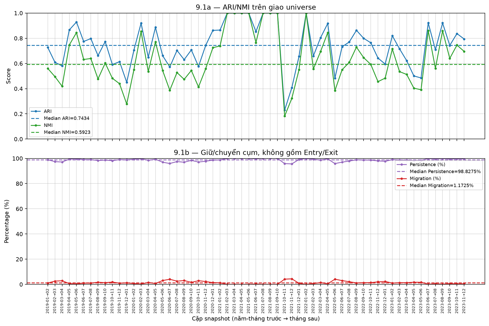
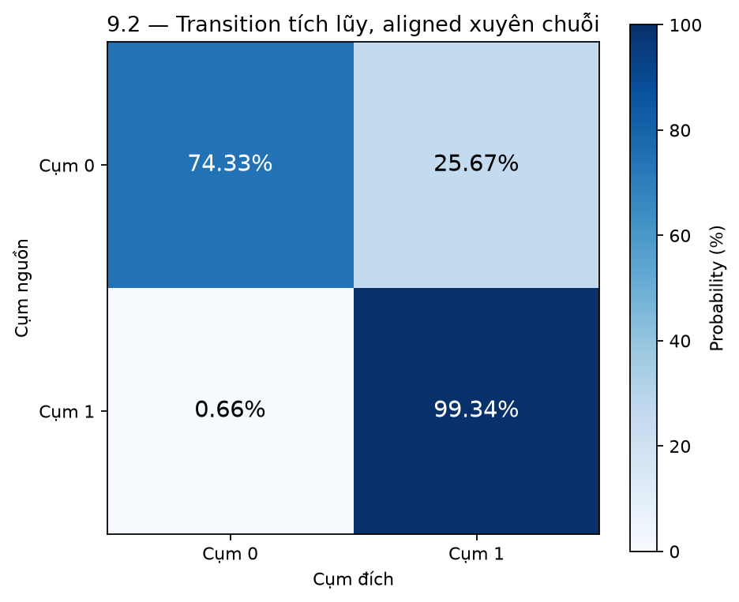

# Báo cáo Nhiệm vụ 9 — Temporal Stability PCA + K-Means V2

Nguồn: ba CSV phẳng trong m2-evaluation-pca-kmeans-v2, chuẩn hóa từ Task 6 V2. ARI/NMI không được tính lại; nhãn aligned giữ nguyên; không fit model.

## Bảng 1

| Chỉ số (Metric) | Số cặp quan sát | Trung bình (Mean) | Trung vị (Median) | Nhỏ nhất (Min) | Lớn nhất (Max) |
| --- | --- | --- | --- | --- | --- |
| ARI | 59 | 0.747575 | 0.743427 | 0.230167 | 1.0 |
| NMI | 59 | 0.636082 | 0.592307 | 0.182405 | 1.0 |
| Persistence (%) | 59 | 98.640468 | 98.827471 | 95.614035 | 100.0 |
| Migration (%) | 59 | 1.359532 | 1.172529 | 0.0 | 4.385965 |

## Bảng 2

| Từ Cụm (From) | Sang Cụm (To) | Tổng số lượt (Count) | Tổng số cơ sở (Denominator) | Tỷ lệ xác suất (Rate %) |
| --- | --- | --- | --- | --- |
| Cụm 0 | Cụm 0 (Giữ nguyên) | 498 | 670 | 74.328358 |
| Cụm 0 | Cụm 1 (Chuyển cụm) | 172 | 670 | 25.671642 |
| Cụm 1 | Cụm 1 (Giữ nguyên) | 26492 | 26669 | 99.336308 |
| Cụm 1 | Cụm 0 (Chuyển cụm) | 177 | 26669 | 0.663692 |

## Bảng 3

| Đặc trưng | Độ lệch tuyệt đối Cụm 0 (Mean \|Delta\|) | Độ lệch tuyệt đối Cụm 1 (Mean \|Delta\|) |
| --- | --- | --- |
| liquidity_21 (tỷ VND) | 73.55519 | 1.635837 |
| beta_126 | 0.150382 | 0.037246 |
| vol_63 | 0.076999 | 0.026047 |
| mdd_126 | 0.043221 | 0.014494 |
| mom_21 | 0.111403 | 0.049092 |
| mom_63 | 0.232845 | 0.058394 |
| mom_126 | 0.335038 | 0.059247 |
| mom_252 | 0.396687 | 0.080186 |

## Bảng 4

| Cặp Snapshot (From -> To) | Số mã chung (n_common) | Số mã mới (Entry) | Số mã rớt (Exit) | Tỷ lệ luân chuyển (%) |
| --- | --- | --- | --- | --- |
| 2019-01 → 2019-02 | 655 | 1 | 1 | 0.305344 |
| 2019-02 → 2019-03 | 656 | 6 | 0 | 0.914634 |
| 2019-03 → 2019-04 | 660 | 9 | 2 | 1.666667 |
| 2019-04 → 2019-05 | 661 | 19 | 8 | 4.08472 |
| 2019-05 → 2019-06 | 676 | 19 | 4 | 3.402367 |
| 2019-06 → 2019-07 | 693 | 13 | 2 | 2.164502 |
| 2019-07 → 2019-08 | 705 | 56 | 1 | 8.085106 |
| 2019-08 → 2019-09 | 761 | 20 | 0 | 2.628121 |
| 2019-09 → 2019-10 | 746 | 25 | 35 | 8.042895 |
| 2019-10 → 2019-11 | 764 | 9 | 7 | 2.094241 |
| 2019-11 → 2019-12 | 631 | 42 | 142 | 29.160063 |
| 2019-12 → 2020-01 | 597 | 16 | 76 | 15.410385 |
| 2020-01 → 2020-02 | 612 | 19 | 1 | 3.267974 |
| 2020-02 → 2020-03 | 490 | 5 | 141 | 29.795918 |
| 2020-03 → 2020-04 | 451 | 3 | 44 | 10.421286 |
| 2020-04 → 2020-05 | 445 | 8 | 9 | 3.820225 |
| 2020-05 → 2020-06 | 394 | 7 | 59 | 16.751269 |
| 2020-06 → 2020-07 | 394 | 9 | 7 | 4.060914 |
| 2020-07 → 2020-08 | 394 | 9 | 9 | 4.568528 |
| 2020-08 → 2020-09 | 394 | 0 | 9 | 2.284264 |
| 2020-09 → 2020-10 | 378 | 17 | 16 | 8.730159 |
| 2020-10 → 2020-11 | 309 | 6 | 86 | 29.773463 |
| 2020-11 → 2020-12 | 312 | 50 | 3 | 16.987179 |
| 2020-12 → 2021-01 | 360 | 110 | 2 | 31.111111 |
| 2021-01 → 2021-02 | 401 | 0 | 69 | 17.206983 |
| 2021-02 → 2021-03 | 207 | 55 | 194 | 120.289855 |
| 2021-03 → 2021-04 | 235 | 38 | 27 | 27.659574 |
| 2021-04 → 2021-05 | 249 | 1 | 24 | 10.040161 |
| 2021-05 → 2021-06 | 241 | 81 | 9 | 37.344398 |
| 2021-06 → 2021-07 | 309 | 2 | 13 | 4.854369 |
| 2021-07 → 2021-08 | 240 | 1 | 71 | 30.0 |
| 2021-08 → 2021-09 | 166 | 0 | 75 | 45.180723 |
| 2021-09 → 2021-10 | 143 | 2 | 23 | 17.482517 |
| 2021-10 → 2021-11 | 145 | 28 | 0 | 19.310345 |
| 2021-11 → 2021-12 | 114 | 2 | 59 | 53.508772 |
| 2021-12 → 2022-01 | 116 | 0 | 0 | 0.0 |
| 2022-01 → 2022-02 | 116 | 40 | 0 | 34.482759 |
| 2022-02 → 2022-03 | 156 | 105 | 0 | 67.307692 |
| 2022-03 → 2022-04 | 215 | 38 | 46 | 39.069767 |
| 2022-04 → 2022-05 | 253 | 14 | 0 | 5.533597 |
| 2022-05 → 2022-06 | 267 | 2 | 0 | 0.749064 |
| 2022-06 → 2022-07 | 234 | 4 | 35 | 16.666667 |
| 2022-07 → 2022-08 | 237 | 27 | 1 | 11.814346 |
| 2022-08 → 2022-09 | 264 | 49 | 0 | 18.560606 |
| 2022-09 → 2022-10 | 303 | 74 | 10 | 27.722772 |
| 2022-10 → 2022-11 | 362 | 4 | 15 | 5.248619 |
| 2022-11 → 2022-12 | 352 | 121 | 14 | 38.352273 |
| 2022-12 → 2023-01 | 471 | 137 | 2 | 29.511677 |
| 2023-01 → 2023-02 | 603 | 2 | 5 | 1.160862 |
| 2023-02 → 2023-03 | 605 | 3 | 0 | 0.495868 |
| 2023-03 → 2023-04 | 600 | 296 | 8 | 50.666667 |
| 2023-04 → 2023-05 | 886 | 5 | 10 | 1.693002 |
| 2023-05 → 2023-06 | 843 | 3 | 48 | 6.049822 |
| 2023-06 → 2023-07 | 841 | 54 | 5 | 7.015458 |
| 2023-07 → 2023-08 | 893 | 6 | 2 | 0.895857 |
| 2023-08 → 2023-09 | 721 | 5 | 178 | 25.381415 |
| 2023-09 → 2023-10 | 724 | 72 | 2 | 10.220994 |
| 2023-10 → 2023-11 | 794 | 103 | 2 | 13.224181 |
| 2023-11 → 2023-12 | 895 | 60 | 2 | 6.927374 |

## A — Phán quyết độ ổn định

Mean/Median ARI = 0.747575/0.743427;
Mean/Median NMI = 0.636082/0.592307.
ARI > 0,70 ở 38/59 cặp.
ARI thấp nhất 0.230167 tại 2021-10-29 → 2021-11-30.
Có 5 cặp ARI < 0,50: 2019-12-31 → 2020-01-31: 0.450166; 2021-10-29 → 2021-11-30: 0.230167; 2021-11-30 → 2021-12-31: 0.408190; 2022-05-31 → 2022-06-30: 0.482463; 2023-05-31 → 2023-06-30: 0.485201.
Vì vậy độ bền phân hoạch có biến thiên đáng kể, không gọi toàn bộ chuỗi là bất biến.
Các cặp suy giảm cần được kiểm tra bối cảnh riêng; không có bằng chứng VN-Index
trong ba CSV để khẳng định nguyên nhân cú sốc thị trường hoặc dòng tiền.

Chuỗi 60 tháng liên tục, đúng 59 cặp từ 2019-01-31 → 2019-02-28
đến 2023-11-30 → 2023-12-29; không có cặp qua gap/holdout.
Drift dùng profile feature gốc cùng aligned ID, không phải khoảng cách tâm PCA;
Mean |Delta| liquidity C0/C1 = 73.555190/
1.635837 tỷ VND/phiên.
Không cộng hay xếp hạng độ lớn drift của các feature khác đơn vị.

## B — Tính bền thành viên và tác động tiềm tàng đến M3

Mean/Median Persistence = 98.640468%/98.827471%;
Mean/Median Migration = 1.359532%/1.172529%.
Theo rubric mô tả Persistence ≥80%, có 59/59 cặp
độ bám nhãn cao. Tuy nhiên tích lũy theo lượt, Cụm 0 giữ 74.3284%,
chuyển sang Cụm 1 25.6716% trên 670 lượt;
Cụm 1 giữ 99.3363%, chuyển sang Cụm 0 0.6637%
trên 26669 lượt. Persistence tổng thể cao che bớt xáo trộn
trong nhóm nhỏ; số lượt không phải số cổ phiếu duy nhất.

Tỷ lệ (Entry+Exit)/n_common cao nhất 120.2899% tại
2021-02-26 → 2021-03-31. Entry/Exit là thay đổi điều kiện
tham gia universe; Migration chỉ tính mã chung. Cả hai chưa phải portfolio turnover.
Migration thấp gợi ý ít đổi nhãn trên giao universe, nhưng không bảo đảm giao dịch/thuế
hay slippage thấp. M3 phải xác định vốn, tỷ trọng, thành viên vào/ra, quy tắc tái cân bằng
và chi phí thực thi; không suy khả năng bảo toàn lợi nhuận từ thống kê nhãn.

## C — Bàn giao Nhiệm vụ 10 và giới hạn

Bằng chứng bao phủ 59/59 cặp, bốn bảng chuẩn và hai biểu đồ, đủ đầu vào so sánh
độ bền với các phương án cùng dữ liệu, universe và 60 tháng development.
Khi bàn giao phải giữ cảnh báo 5 cặp ARI <0,50 và xác suất chuyển của Cụm 0
25.6716%; không chỉ dùng Persistence tổng thể để khẳng định ổn định.
Không tuyên bố PCA tốt hơn các phương án khác khi chưa làm đối đầu Nhiệm vụ 10.
Đây là Temporal Stability Diagnostic, không phải Dynamic Clustering;
không chọn mã, không dùng return/Sharpe/backtest và không mở holdout.

Khi đối chiếu biến động universe ở Nhiệm vụ 10, phải thống nhất mẫu số từ các cột Entry/Exit/n_common; các notebook legacy dùng công thức khác nhau. Bộ V2 này dùng (Entry+Exit)/n_common, nên không so trực tiếp với tỷ lệ dùng mẫu số khác.
