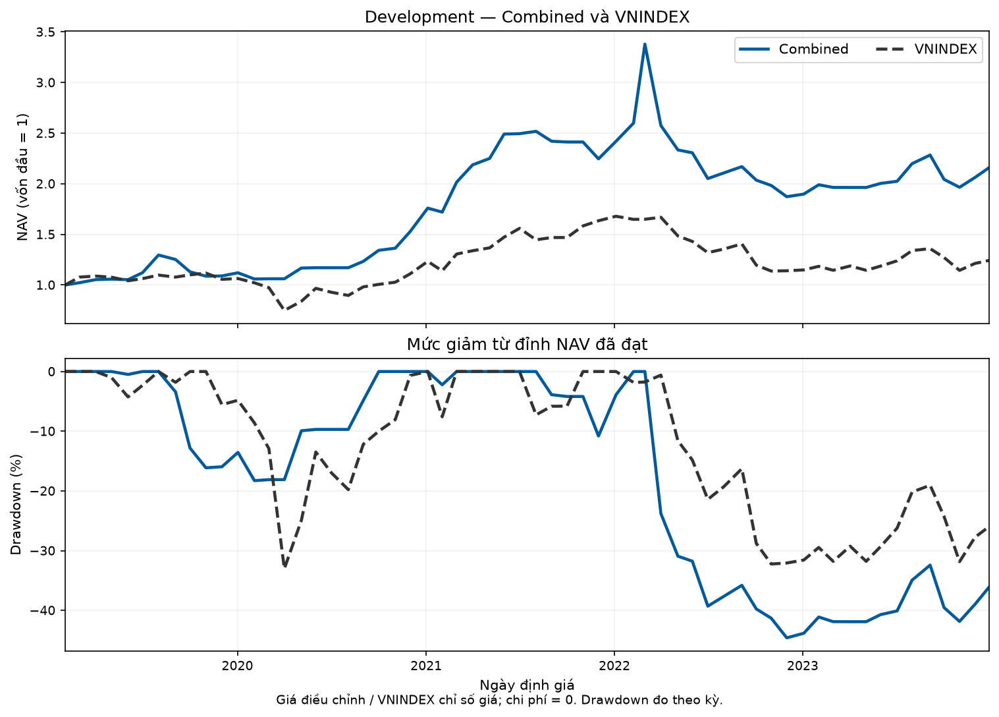
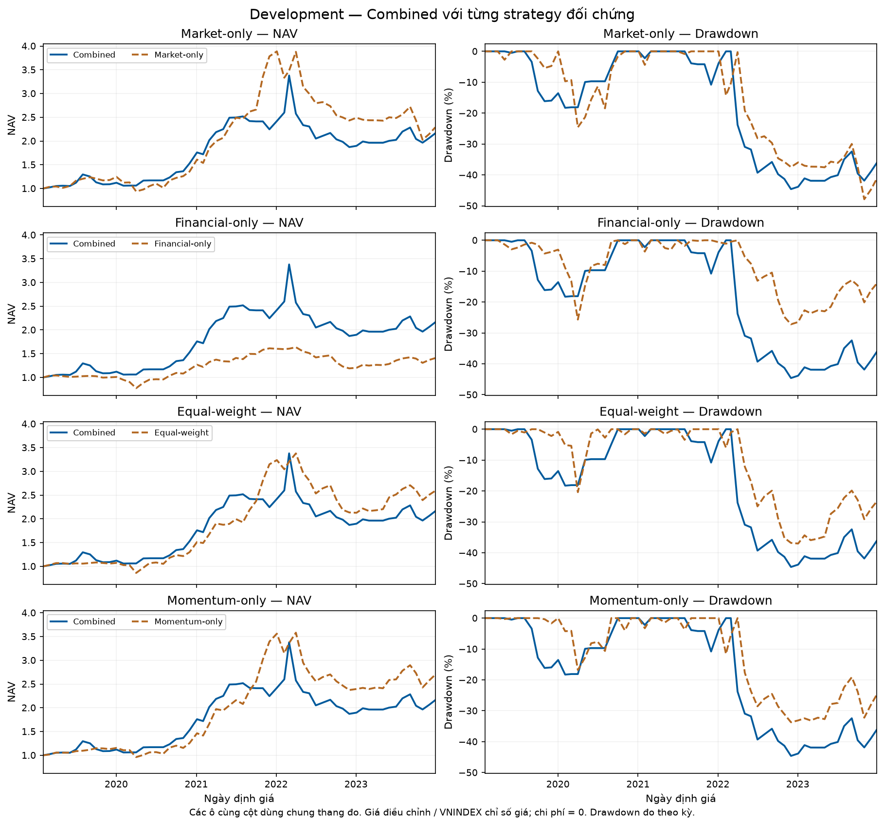
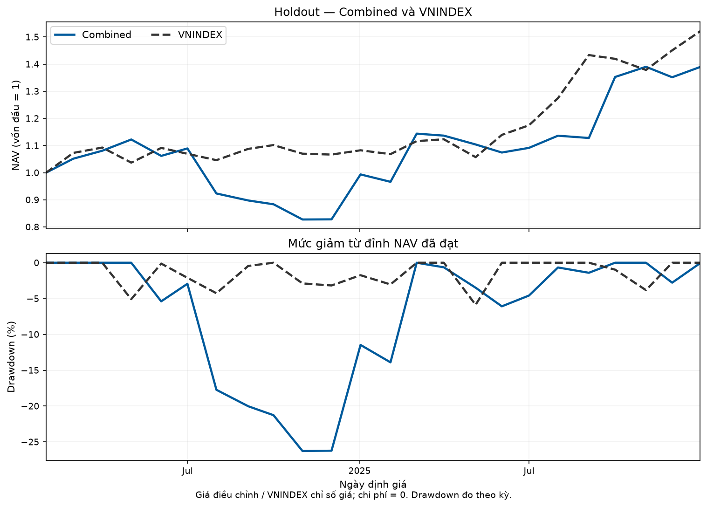
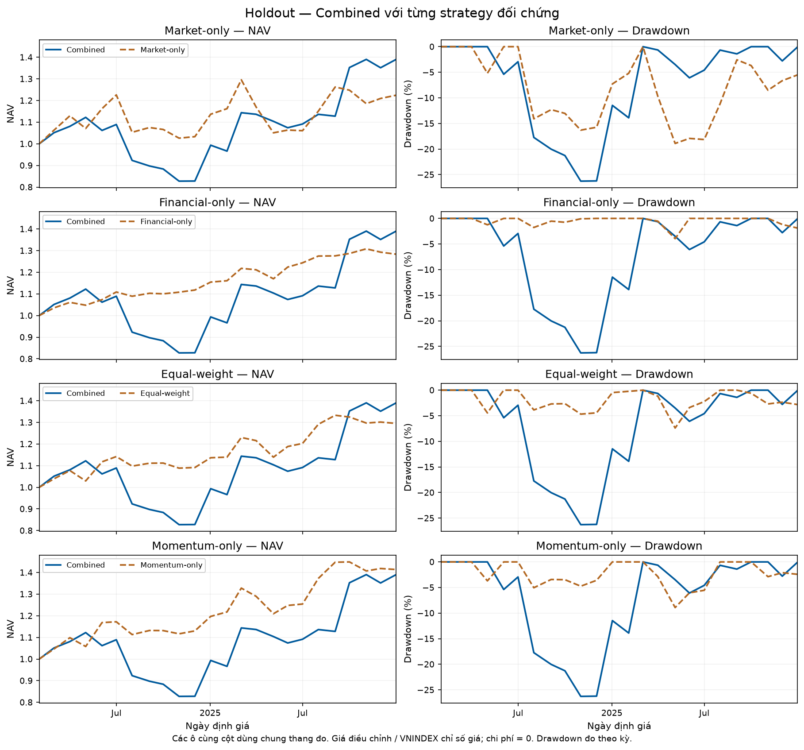

# Báo cáo kỹ thuật M3 — Development và Holdout

**Phạm vi:** phần lịch sử đã tái lập; Final Evaluation `NOT_READY`. M3-C tổng thể `PARTIAL`.

Báo cáo này được sinh bằng các cell của Notebook 03 từ metrics/canonical outputs đã seal. Số liệu được định dạng từ tệp nguồn, không chép tay. Báo cáo tiến độ công việc riêng ở [REPORT_BACKTEST.md](../../docs/REPORT_BACKTEST.md).

## 1. Mục tiêu và câu hỏi nghiên cứu

Đánh giá quy tắc kết hợp trạng thái Market và Financial tại tầng danh mục: Combined có tạo lợi thế về lợi suất và rủi ro so với bốn strategy đối chứng và VNINDEX hay không? Chất lượng cụm, độ ổn định cụm và hiệu quả danh mục là các lớp đánh giá độc lập. Kết quả danh mục không được dùng để chọn lại k, algorithm hoặc rule đã khóa.

## 2. Nguồn dữ liệu, phiên bản và khả năng truy nguyên

- Code nguồn các run: `c9c1f5f0c88f2dbb3ebbb50effa47003b24b66cf`.
- Code thực thi notebook: `c9c1f5f0c88f2dbb3ebbb50effa47003b24b66cf`; các module M3 đã đối chiếu với commit nguồn.
- Config: `configs/experiments/m3_strategy_v1.json`, status `LOCKED`.
- SHA256 config: `b5c47ac458cca35e29e99f1cd8cde2827778fbffd8bb2fccf942a6cc9a42e72d`.
- Dataset revision: `08c24867b11177072bfe457a4623a38abf9bbc48`.

| Đầu vào | Path local từ gốc repository | SHA256 |
|---|---|---|
| terminal_sha256 | `data/web/delta-intelligence-v4/terminal.sqlite` | `0662585b95a7d529854dbcea8816e47e24466dc55ff1368cbe923c018c5670e9` |
| indicators_sha256 | `data/financial/indicators_v1/results/indicators-2c4a24e3830d325f/indicators.sqlite` | `26bfc2d922a8f39f1fb8234e6b50c788ef83ac4b229059ed339a14ebd1213023` |
| availability_sha256 | `data/financial/disclosure_dates_v1/availability-4f0f83108e761dae/availability.csv` | `4f0f83108e761daeb86289e290de3aff0379abbf1ed630ac31c842146186648f` |
| c8_benchmark_sha256 | `artifacts/cafef_primary/cafef-c8-complete-only-v2/canonical/benchmark_daily.jsonl` | `75fc214cb079159fe2df03f29fe9c8075705b24cbb114f09f0e800bf3c4285a2` |
| c8_calendar_sha256 | `artifacts/cafef_primary/cafef-c8-complete-only-v2/canonical/trading_calendar.jsonl` | `9aa4ffd869052654dc5b9ed7f6b19c8339469057fa80dda2a66f9a6aecb68b6f` |
| c8_prices_sha256 | `artifacts/cafef_primary/cafef-c8-complete-only-v2/canonical/prices_daily.jsonl` | `20ecee90df48869fa4ed7196c64ff857775ebd54fcaeb1b93ced76d6635a2b1f` |
| b_pit_labels_sha256 | `data/financial/b_pit_v1/bpit-4a9d2e87f0de84ec/labels.csv` | `4a9d2e87f0de84ec9e80364b24043cb6091aa4f34f7dcfd187d8526e9f44579a` |

| Segment | Run | Seal SHA256 |
|---|---|---|
| development | [20261104T121107Z-5557288c](../../data/experiments/m3/development/20261104T121107Z-5557288c/manifest.json) | `39784248f3777700ebc0261ef53f20053bc4429920785472bba416150e902661` |
| holdout | [20261104T133507Z-5557288c](../../data/experiments/m3/holdout/20261104T133507Z-5557288c/manifest.json) | `f54ea2fb1d0da107d684178c541c9f9c634a11f4de463ad4352e4967ec152cbc` |

Notebook 01 kiểm tra identity/hash và PIT mẫu. Notebook 02 đối chiếu targets/audit đủ từng mã/ngày. Notebook 03 đối chiếu engine và metrics. Evidence từng lần chạy nằm trong `M3/reproduction/`; các file canonical/seal nguồn được kiểm tra giữ nguyên.

## 3. Kiến trúc hai hệ phân cụm

Market dùng mô hình A của bundle v4, k=3, đọc các snapshot thị trường đã có. Financial dùng B-PIT theo công thức B v4, chín chỉ số, winsorize/z-score và K-Means k=3 tại cutoff từng FY; tâm cụm, preprocessing và thứ tự cụm được đóng băng. M3 không gộp hai hệ thành mô hình clustering mới và notebook không fit lại chúng. B v4 chỉ là đối chiếu ARI trong artifact B-PIT.

## 4. Căn thời gian và PIT

Nguồn availability FY trước 2022 dùng LAG_RULE ngày 30/06 năm kế tiếp, usable từ phiên giao dịch quan sát đầu tiên sau ngày đó. Từ FY2022, dùng ngày gửi CafeF và phiên usable tiếp theo theo Q-date. Runtime chọn FY mới nhất đã usable, kiểm tra stale theo config và metadata/cutoff model. FY mới đã usable nhưng model chưa sẵn sàng không được fallback sang FY cũ. Điều kiện ngày này không loại bỏ giới hạn vintage/revision của snapshot Indicators.

Stale tối đa theo config: 18 tháng. Notebook gọi `universe.financial_state` và `Strategies.target_for`; không viết quy tắc PIT thứ hai.

## 5. Candidate Universe và đối chứng

Combined dùng Market rule `leading` giao với Financial rule `not_weakest`, sau các gate thanh khoản, sector, availability, model cutoff và tính đầy đủ tiêu chí. Financial loại BANK/SECURITIES/INSURANCE do không có nhãn B phù hợp. Thiếu một phần tiêu chí được chấm percentile trung tính 0,5 và ghi flag; thiếu toàn bộ FC bị loại trước N_min. Universe audit lưu lý do theo từng mã/ngày.

- Market-only: chọn theo cụm Market dẫn dắt và điểm Market.
- Financial-only: Financial Eligible Pool giao traded universe; chấm điểm Financial.
- Equal-weight: chia đều tập mã không bị ILLIQUID của snapshot.
- Momentum-only: top-share theo mom_126 trên tập đủ điều kiện, không dùng cluster để chọn.
- VNINDEX: benchmark chính thức, không phải strategy thứ sáu.

## 6. Sáu tiêu chí và xếp hạng

| Nhóm | Tiêu chí | Chiều tốt hơn |
|---|---|---|
| Market | `mom_126` | Cao hơn |
| Market | `downside_vol_63` | Thấp hơn |
| Market | `liquidity_21` | Cao hơn |
| Financial | `roe` | Cao hơn |
| Financial | `f_score` | Cao hơn |
| Financial | `z_score` | Cao hơn |

Mỗi tiêu chí được chuyển sang average-rank percentile trong tập chấm điểm cùng kỳ. S_market và S_fin là trung bình các percentile của từng nhóm. Điểm Combined = 0.5 × S_market + 0.5 × S_fin. Tie-break: điểm giảm dần, liquidity_21 giảm dần, ticker tăng dần. Chọn ceil(0.3 × N_candidates); trọng số mục tiêu bằng nhau. Với strategy áp dụng N_min=10, kỳ không đủ ứng viên không tạo mua mới: giữ tỷ trọng mã cũ còn hợp lệ, bán mã đã ra khỏi tập ứng viên theo Q6.

## 7. Giao dịch, tiền mặt và bốn bước

Bước 1 tạo target tại decision date. Bước 2 revalue và giao dịch tại phiên tiếp theo: SELL trước BUY; volume 0 hoặc thiếu giá chặn giao dịch, chạm trần chặn BUY, chạm sàn chặn SELL, thiếu giới hạn giá fail-closed. SELL_FAILED giữ vị thế, BUY_FAILED giữ tiền; thiếu tiền thì giảm đồng tỷ lệ các lệnh mua còn thực hiện được. Bước 3 giữ và định giá đến execution kế tiếp hoặc end_date. Bước 4 chuyển trạng thái danh mục, không thực hiện thêm một lần giao dịch.

Engine hoạt động trong value space, vốn ban đầu = 1, vị thế cho phép phân số và không làm tròn lô. `cash`, `nav`, `intended`, `executed` là giá trị vốn chuẩn hóa; `weight` là tỷ trọng. Cash ratio = cash/NAV. Turnover = tổng executed hai chiều/(2 × pre_trade_NAV). Missing price giữ last valid mark và ghi PRICE_STALE. Q17 chỉ sửa giá runtime khi đủ ba phiên exchange liền kề trong segment; raw input giữ nguyên. Cash sinh lãi 0; cost/slippage baseline = 0.

## 8. Kết quả lịch sử đã đối chiếu

Hai đoạn khởi tạo độc lập từ 100% CASH. Tổng lợi suất không so trực tiếp giữa các đoạn dài khác nhau; CAGR dùng số khoảng lợi suất/12 năm. Biến động năm dùng độ lệch chuẩn mẫu lợi suất theo kỳ × √12. Max drawdown chỉ đo tại ngày NAV được lưu, không phải daily drawdown. Không tính Sharpe cho Dev/Holdout.

### Development

Decision window `2019-01-31` → `2023-12-29`; 60 decisions, 59 executions, 1 kỳ cuối không execution. Có 59 khoảng lợi suất.

| Strategy/benchmark | Tổng lợi suất | CAGR | Biến động năm | Max drawdown | Turnover TB | Cash TB | Kỳ dưới N_min |
|---|---:|---:|---:|---:|---:|---:|---:|
| Combined | 116,15% | 16,97% | 27,39% | -44,60% | 47,62% | 22,40% | 13 |
| Market-only | 128,81% | 18,34% | 29,51% | -47,88% | 53,99% | 6,22% | 0 |
| Financial-only | 40,74% | 7,20% | 17,09% | -27,20% | 17,69% | 1,02% | 0 |
| Equal-weight | 159,03% | 21,36% | 24,45% | -37,01% | 11,89% | 0,48% | 0 |
| Momentum-only | 169,73% | 22,36% | 25,51% | -33,71% | 31,54% | 1,47% | 0 |
| VNINDEX | 24,35% | 4,53% | 23,56% | -33,02% | — | — | — |

| Strategy | BUY_FAILED | SELL_FAILED | SCALED | PRICE_STALE | LIMIT_DATA_MISSING |
|---|---:|---:|---:|---:|---:|
| Combined | 47 | 33 | 263 | 2 | 0 |
| Market-only | 96 | 62 | 537 | 3 | 0 |
| Financial-only | 267 | 280 | 1301 | 9 | 0 |
| Equal-weight | 1836 | 2027 | 11115 | 111 | 0 |
| Momentum-only | 661 | 739 | 2735 | 26 | 0 |

Các số failed/scaled/stale là số sự kiện, không phải số mã duy nhất.

### Holdout

Decision window `2024-01-31` → `2025-12-31`; 24 decisions, 23 executions, 1 kỳ cuối không execution. Có 23 khoảng lợi suất.

| Strategy/benchmark | Tổng lợi suất | CAGR | Biến động năm | Max drawdown | Turnover TB | Cash TB | Kỳ dưới N_min |
|---|---:|---:|---:|---:|---:|---:|---:|
| Combined | 38,95% | 18,72% | 28,59% | -26,27% | 54,53% | 8,92% | 1 |
| Market-only | 22,43% | 11,14% | 23,75% | -18,91% | 58,52% | 3,75% | 0 |
| Financial-only | 28,37% | 13,92% | 7,30% | -3,95% | 24,37% | 2,54% | 0 |
| Equal-weight | 29,53% | 14,45% | 13,34% | -7,40% | 8,41% | 0,47% | 0 |
| Momentum-only | 41,37% | 19,80% | 15,60% | -8,92% | 27,50% | 0,82% | 0 |
| VNINDEX | 52,13% | 24,47% | 16,08% | -5,87% | — | — | — |

| Strategy | BUY_FAILED | SELL_FAILED | SCALED | PRICE_STALE | LIMIT_DATA_MISSING |
|---|---:|---:|---:|---:|---:|
| Combined | 17 | 23 | 93 | 3 | 0 |
| Market-only | 40 | 25 | 254 | 5 | 0 |
| Financial-only | 123 | 96 | 614 | 1 | 0 |
| Equal-weight | 1073 | 1169 | 9019 | 29 | 0 |
| Momentum-only | 409 | 464 | 2430 | 6 | 0 |

Các số failed/scaled/stale là số sự kiện, không phải số mã duy nhất.

## 9. Phân tích kết quả đối sánh

**Qua hai đoạn:** CAGR Combined tăng từ 16,97% lên 18,72%. Thứ hạng lợi suất trong năm strategy tăng từ thứ 4 lên thứ 2. Thứ hạng còn phụ thuộc kết quả các đối chứng và giai đoạn thị trường, nên chưa chứng minh khả năng khái quát tốt hơn. Hai đoạn không phải kiểm định thống kê về hiệu quả tương lai.

**Market-only:** trong Dev, Combined có CAGR thấp hơn 1,36 điểm phần trăm nhưng biến động và drawdown thuận lợi hơn. Trong Holdout, CAGR cao hơn 7,59 điểm phần trăm, đổi lại biến động cao hơn 4,85 điểm phần trăm và drawdown sâu hơn 7,37 điểm phần trăm. Lợi thế kết hợp chưa nhất quán trên cả lợi suất và rủi ro; chưa tách được đóng góp nhân quả của Financial.

**Financial-only:** Combined có CAGR cao hơn trong cả hai đoạn, nhưng cũng biến động và sụt giảm lớn hơn. Trong Holdout, phần CAGR tăng thêm 4,81 điểm phần trăm đi cùng biến động 28,59% so với 7,30%. Đây là đánh đổi giữa lợi suất và rủi ro, chưa phải ưu thế đồng thời.

**Equal-weight:** trong Dev, đối chứng chia đều có CAGR cao hơn, biến động thấp hơn và drawdown ít sâu hơn Combined. Sang Holdout, Combined có CAGR cao hơn 4,27 điểm phần trăm, nhưng drawdown sâu hơn 18,88 điểm phần trăm. Quy trình chọn lọc chưa thể hiện lợi ích xuyên suốt hai đoạn; chưa phân rã nguồn rủi ro tăng.

**Momentum-only:** có CAGR cao hơn, biến động thấp hơn và drawdown ít sâu hơn Combined trong cả Dev lẫn Holdout. Khoảng cách CAGR trong Holdout còn 1,08 điểm phần trăm, nhưng biến động Combined vẫn cao hơn 13,00 điểm phần trăm. Đây là đối chứng bất lợi rõ nhất cho giả thuyết phương án kết hợp phức tạp tạo thêm hiệu quả. Nhận định này mô tả ba chỉ tiêu, chưa xét ý nghĩa thống kê hoặc hiệu quả sau phí.

**VNINDEX:** Combined cao hơn về lợi suất trong Dev, thấp hơn trong Holdout và drawdown sâu hơn trong cả hai đoạn. Vì khác return basis, không diễn giải phần chênh lệch thành alpha đã được xác nhận.

**Điều kiện vận hành:** Combined có 13/60 quyết định dưới N_min trong Dev và 1/24 trong Holdout. Cash TB giảm từ 22,40% xuống 8,92%; turnover TB tăng từ 47,62% lên 54,53%. Đây là bối cảnh thay đổi mức vốn tham gia thị trường và giao dịch, chưa phải phân tích nguyên nhân của chênh lệch lợi suất. Turnover khác nhau khiến thứ hạng sau chi phí vẫn chưa được xác định.

## 10. Giới hạn dữ liệu và phương pháp

- Strategy dùng vendor-adjusted close như adjusted-return proxy; VNINDEX là price index. Khác biệt cơ sở giá ảnh hưởng cả lợi suất và drawdown. Chưa tách đóng góp cổ tức để định lượng chênh lệch.
- Secondary price-only chưa sẵn sàng. Không thay raw_close trực tiếp vì sự kiện vốn có thể gây biến động giá cơ học. Chưa tái lập đầy đủ một total-return benchmark tương đồng.
- Drawdown đo theo kỳ; missing price có dùng last valid mark. Không mặc định thiếu dữ liệu bằng zero.
- Chi phí/slippage 0, vị thế phân số, không có sổ lệnh hoặc ràng buộc sức chứa dựa trên quy mô vốn thực. Volume/trần/sàn chỉ là rule executable đã khóa.
- Financial vintage/revision và các phát hiện VCG/SBT được owner chấp nhận như giới hạn snapshot; PIT ngày/cutoff không xác nhận số tài chính là vintage nguyên thủy. Xem [disclosure nguồn](../../docs/REPORT_BACKTEST.md#32-q-date-và-các-điểm-cần-xác-minh-về-dữ-liệu-tài-chính).
- Độ ổn định B v4 chưa đạt ngưỡng mong muốn là giới hạn upstream; notebook không lựa chọn lại model bằng kết quả danh mục. Holdout sạch ở tầng portfolio-rule/return-based evaluation, không khẳng định hoàn toàn unseen đối với mọi lịch sử lựa chọn mô hình upstream.

## 11. Final Evaluation và trạng thái M3-C

**Final = NOT_READY:** owner xác nhận chưa đủ dữ liệu 2026; chưa có segment/window Final và run Final đã seal. Notebook 04 ghi trạng thái chờ, không tạo số liệu hoặc dùng Holdout thay Final. M3-C phần Dev/Holdout có bằng chứng tái lập; tổng thể vẫn PARTIAL cho đến khi đánh giá Final hoàn tất.

## 12. Hướng dẫn tái lập và ranh giới dashboard

Xem [hướng dẫn thực thi](../HUONG_DAN_THUC_HIEN_M3.md) và bộ notebook ở `M3/notebooks/`. Mỗi lần thực thi lưu preflight, đối chiếu ba notebook, hash notebook/report/biểu đồ và môi trường trong thư mục reproduction riêng. Không cần chạy lại acquisition hoặc build B-PIT.

M3-B là lớp dashboard đọc versioned/sealed artifacts; phần này không xây gói dashboard hoặc kiểm thử API/frontend thay M3-B. Báo cáo chưa có bằng chứng nghiệm thu dashboard mới.

## 13. Kết luận trong phạm vi lịch sử

Combined cải thiện thứ hạng ở Holdout nhưng chưa có ưu thế nhất quán đồng thời về lợi suất và rủi ro. Momentum-only thuận lợi hơn trên CAGR, volatility và drawdown ở cả hai đoạn. Verify/reproduction PASS xác nhận tuân thủ contract và khả năng tái lập, không chứng minh hiệu quả đầu tư vượt trội hoặc chất lượng phân cụm tốt hơn. Quy tắc frozen được giữ nguyên sau đánh giá.
